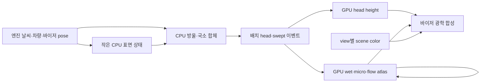

# CSP 기반 RainFX 새 구현안

2026-10-25. **설계 제안이며 새 렌더러가 구현·성능 검증됐다는 뜻이 아니다.**
사용자 요청에 따라 기존 P0의 수치 모델·필드 형식·원장·모듈을 승계해야 한다는
전제를 배제했다. 기존 앱은 별도로 보존하며, 이 설계는 별도 경로로 개발한다.
“최적”은 세 영상의 표현력, CSP 공개 API로 구현할 가능성, 개발·실행 비용을 함께
고려한 현재의 추천이다. 측정 없이 모든 GPU에서 최적이라고 증명한 것은 아니다.

## 결론

**CPU의 작은 표면 방울 시뮬레이션 + 배치 메시를 이용한 GPU 스탬핑 +
낮은 해상도의 표면 상태 + 한 번의 바이저 광학 합성**을 권한다.

물방울 하나하나의 생명주기·이동·흡수는 CPU가 소유하고, GPU는 화면의 디테일과
젖음·산란·흐름의 표현을 담당한다. CPU가 그려진 GPU 결과를 다시 읽어 의사결정하는
왕복을 없앤다. 매 구간 원장 승인·GPU 완료 readback·다단계 시간 부채 큐는 두지 않는다.
프레임별 방울 렌더는 배치하며 방울마다 Lua draw 호출을 하지 않는다.



GPU field에서 CPU 의사결정으로 돌아가는 readback 화살표는 없다.

## 영상에서 요구하는 것

기존 추출본 A/B/C의16개 시점씩48개 표본을 다시 검토했다. 원본 MP4의 모든 연속
프레임을 이번에 재디코딩한 것은 아니다. 표본은
`diagnostics/2026-10-25/target_scenes/`에 남긴다. 물성·mm/h를 영상으로 실측하지 않는다.

| 목표 | 영상의 핵심 | 구현 수단 |
| --- | --- | --- |
| C: 약한 비 | 대부분 맑음, 드문 방울의 고착과 이동, 넓은 수막 거의 없음 | 입사량이 적으면 작은 방울 계열만 남고 표면 상태는 자연히 낮은 평형으로 수렴 |
| B: 중간비·고속 | 작은 방울, 가는 사선 흔적, 국소 haze와 선명한 길의 공존 | 같은 이동 구간이 잔류 흔적과 미세 산란 제거를 함께 생성; 고속 배출·국소 재유입 |
| A: 많은 물/물보라 | 충돌·짧은 퍼짐, 연결된 흐름, 강하고 변하는 굴절 | burst 입사, 움직이는 넓은 리본·국소 sheet, 같은 젖음 상태에 묶인 유한 수명 광학 변화 |

A의 공중 물보라·원경 흐림·카메라 노출은 표면 효과와 구분한다. 게임의 기존 날씨·
입자 표현을 사용하며, 화면 전체 blur를 바이저 haze로 복제하지 않는다.

## 대안 비교

| 방식 | 이점 | 한계 | 판단 |
| --- | --- | --- | --- |
| CSP 기본 windshield RainFX를 바이저에 적용 | 엔진 구현 재사용 가능성 | Lua로 로드한 임의 바이저에 원하는 물리·haze·트레일을 제어해 붙이는 공개 경로가 확인되지 않음 | 짧은 조사 후보일 뿐 주 구현의 선행조건으로 삼지 않음 |
| 절차적 fullscreen 물방울 셰이더만 사용 | 매우 간단하고 빠른 첫 화면 | 방울 경로·흡수·닦인 길의 일관성과 G-force 반응이 약함 | 미세 디테일 보조로 제한 |
| GPU의 정밀 질량 수송·입사·완료 승인 | 복잡한 물리 모델 연구 가능 | 많은 패스·소유권·디버깅, 화면보다 승인 체계에 개발이 묶일 위험 | 이 목표에는 채택하지 않음 |
| CPU 방울 + GPU 표면 표현 | 상호작용 디버깅이 쉽고 GPU 왕복 불필요, 배치 렌더 가능 | LuaJIT/vertex upload 비용은 실제 측정 필요 | **우선 채택** |

CPU를 고르는 이유는 GPU가 느려서가 아니다.2048–4096개의 작은 상태와 국소
공간 해시는 CPU에서 직접 제어하기 쉬우며, CSP API 제약 아래서 전체 구조가 단순해진다.

## 상태와 데이터 소유권

### CPU: 움직이는 물의 원인

방울은 미리 할당한 연속 배열/FFI 버퍼에 저장한다. UV 위치·속도·이전 위치·물리 체적·
나이·고착 상태·세대·표현 크기를 구분한다. 매 프레임 Lua table을 N개 생성하지 않는다.

- 입사: 강수/상대풍/법선 노출을 기반으로 유한 birth rate를 정한다. 강수는 모든 방울의
  크기 배율이 아니며 작은/중간/큰 크기의 확률 분포를 바꾼다.
- 충돌: 즉시 붙는 방울, micro 분율, 짧은 impact stamp를 한 이벤트에서 만든다.
  큰 유입을 한 개의 거대 방울로 확대하지 않는다.
- 운동: 표면 접선에 투영한 중력·차량 관성·상대풍, 크기별 이탈 임계와 이동 저항을
  사용한다. 저속 힘의 흔들림은 dead zone/짧은 필터로 처리한다.
- 흡수/합체: 균일 공간 해시에서 자기 셀과 인접 셀만 검색한다. 가까운 실제 방울끼리
  합치고 체적으로 크기를 구한다. 이 기능을 초기 C 단계부터 포함한다.
- 닦임: 이동한 동일 구간이 head→trail 기여와 haze 제거 이벤트를 만든다.
  화면에 보이는 방울과 무관한 별도 wipe 경로를 만들지 않는다.
- 경계: bake된 표면의 연결·유효 영역을 따르며 UV 섬 사이를 wrap하지 않는다.
  외부로 빠져나간 물은 exit 처리한다.

CPU에 작은128×32 표면 상태 격자를 둬 최근 공급·미세 젖음·잔류·배출을 추적한다.
메트릭·유효 영역은 기존/새 bake에서 CPU용 작은 격자로 읽는다. 프레임 공통 pose/힘을
한 번 계산하고 각 방울은 scalar/FFI 상태와 격자 조회만 사용한다. 방울마다 엔진 mesh
query, 새 vec3/table, 파일 접근이나 큰3D 행렬 구성을 수행하지 않는다.
이는 접착/경로 선호/큰 흐름 발생을 위한 **저해상 재질 상태**다. GPU optical field와
셀별 동일한 미크론 두께·질량장을 이중으로 시뮬레이션한다고 주장하지 않는다.
GPU 시각 결과를 CPU로 읽어 이 격자를 갱신하지 않는다.

고밀도 셀의 이웃 탐색은 상한을 둔다. 후보가 넘치면 가장 가까운/큰 방울과의
제한적 합체 또는 해당 셀의 미해상 젖음으로 처리한다. 매 방울 전역 N개 검색은 금지한다.

### GPU: 국소적인 표면 외관

권장 시작값은 다음과 같다. VRAM 크기 자체보다 fill rate·upload·pass 비용을 측정한다.

| 자원 | 시작 해상도/형식 | 역할 |
| --- | --- | --- |
| head height |4096×1024 R16F | 배치된 방울의 analytic cap 높이/coverage |
| event atlas |1024×256 RGBA16F | 최근 deposit·micro 입사·clear·impact 기여 |
| surface A/B |1024×256 RGBA16F ping-pong | 젖음 coverage·미세 산란·흐름 활성·최근 입사 |
| normal/optical atlas | 필요할 때만 추가 | 최종 shader의 gradient 비용이 병목일 때만 캐시 |

처음에는 head8MiB + event2MiB + surface4MiB, 합계 약14MiB다. scene copy/mips,
geometry/CPU 버퍼/선택적 normal atlas는 별도다. 이 숫자는 전체 앱 VRAM이 아니다.
R16F/RGBA16F의 실제 render/blend 동작은 최초 게임 장면에서 확인한다.

표면 atlas는 **광학 coverage/roughness/activity**다. 그 값을 실제 film µm라고
표시하지 않는다. 머리의 실제 크기와 sheet의 optical 강도를 각기 다른 의미로 교정하되,
같은 이벤트·위치·시간·지속 상태로 연결한다. 물리량처럼 보이는 허위 단위를 만들지 않는다.

## 표면 상태의 평형과 세 효과의 조합

개념적으로 위치별 wet/activity W와 micro scatter M을 다음처럼 갱신한다.

```text
W_next = saturate(advect(W, surfaceFlow, dt) * exp(-drainRate * dt)
                  + localDeposit + burstSupply)
M_next = saturate(advect(M, surfaceFlow, dt) * exp(-clearRate * dt)
                  + microImpact - sweptCollection)
sheetActivity = thresholdWithHysteresis(W, recentBurst, shear)
```

이것은 물리 질량 solver가 아니라 재질/광학 상태의 안정적인 게임 근사다. 그 감소를
실제 수분의 증발량이라고 부르지 않는다. 배출·합류·미해상 재분포로 시야가 좋아질 수
있으며 실제 습도가 높아도 B의 선명한 길을 만들 수 있다. 습도는 장기 마름에 관여하되
micro가 영구히 화면 전체를 채우는 강제 하한은 두지 않는다.

CPU 상태와 GPU 상태는 같은 공급·흐름·clear 이벤트를 받는다. GPU는 세부 외관의
advect/decay를 수행한다. 낮은 공급에서는 제거가 공급을 넘는 평형을 갖고, 큰 입사
burst에서는 sheet 활성도가 일시적으로 커진다. rainWetness/rainWater를 W로 복제하지 않는다.

### 고착 방울·얇은 길

정지 방울은 시간에 따라 랜덤 위치가 바뀌지 않는다. 접촉각과 체적으로 모양을 정하고
재질별 이탈 임계를 둔다. 미세한 표면 요철은 정적 spatial noise로만 약하게 반영한다.
흐르는 head와 그 프레임의 swept capsule은 같은 보간 위치·속도를 사용한다.
잔류량이 적을수록 가늘고 짧게 사라지며, 모든 이동에 두꺼운 trail을 남기지 않는다.

### haze와 선명한 길

M은 수많은 subpixel 방울의 산란/normal variance를 표현한다. 고정 procedural
pattern을 매 프레임 원래 값으로 복구하지 않는다. 실제 새 입사가 있어야 다시 채워진다.
같은 head 경로의 clear 이벤트가 M을 낮추고, 필요한 작은 wet 기여를 남긴다.
표시상 맑아짐을 무조건 물0 또는 고속 증발로 해석하지 않는다.

### 국소 flow·sheet·impact

큰 공급과 W가 충분할 때만, 유한 수명의 넓은 ribbon/film patch가 생성된다.
저주파 흐름 무늬를 flow-map으로 변형하되 입사 이벤트·법선·바람에 방향/강도를 묶는다.
두 phase의 advected noise를 crossfade해 반복을 줄이고, dry 영역에서는 영향0이다.
기본 노이즈만으로 거대한 렌즈가 항상 남는 표현은 금지한다.

impact는 충돌 위치에서 빠르게 퍼졌다가 방울/잔류 상태로 이어진다. 넓은 sheet가
필요한 A에서만 활동이 많아지고, B의 고속이라는 이유만으로 전면 sheet를 강제하지 않는다.

## CSP에서의 구체적인 렌더 경로

공개 SDK와 로컬 API 문서에서 확인한 경로를 사용한다.

1. `ac.VertexBuffer`/`ac.IndicesBuffer`와 `createMesh()`로 고정 용량 atlas 메시를 만든다.
2. CPU가 한 번에 vertices를 갱신하고 `alterVertices()`로 배치 업로드한다.
3. `GeometryShot`의 opaque callback에서 `render.mesh()`로 atlas 메시만 렌더한다.
   `setOrthogonalParams()`를 사용하고 게임 월드·차량·sky·particles를 다시 그리지 않는다.
4. `ExtraCanvas:updateWithShader()`로 event를 소비해 surface ping-pong 한 번을 수행한다.
5. 기존 바이저 mesh UV를 통해 head/surface를 읽고 scene color를 굴절시킨다.
   scene copy는 같은 view에서 필요한 한 번으로 공유한다.

GPU instancing·compute/UAV·SSBO·임의 texture upload가 Lua에 있다고 가정하지 않는다.
배치 메시의 UV는 local shape 좌표를 담고, atlas의 직교 깊이/별도 고정 batch parameter로
cap 높이를 전달하는 방식을 첫 장면에서 확인한다. 공개 버텍스 형식의 private extras를
데이터 통로로 쓰지 않는다. pixel shader의 camera-relative depth convention과
normal/height 출력은 엔진에서 확인할 구현 세부이며, 검증 완료 API처럼 포장하지 않는다.

4096 quad는16,384 vertices로16-bit 인덱스 범위 안이다. SDK의44byte vertex 기준
약0.688MiB/frame,60FPS에서 약41.3MiB/s의 nominal upload다. Lua 쓰기·복사·드라이버
stall은 이 전송량만으로 예측할 수 없다. 측정 후 필요할 때만 pinned/moving batch를
나누어 정지 방울 메시를 재사용한다. 처음부터 수십 개 mesh/variant를 만들지 않는다.

head·ribbon·impact는 각기 작은 batch다. N개 `ui.drawImageQuad`나 N개 `render.mesh`
호출, 모든4K pixel에서 N개 방울을 훑는 루프를 두지 않는다.

초기화에서 고정 shader/binding schema를 준비한다. async shader가 pending이면
준비 중으로 표시하고 마지막 유효 atlas를 유지한다. 정상 운영 중 schema를 늘리지 않는다.
각 pass는 보통2–8개 texture 입력으로 제한한다. SDK의 최대 개수를 채우는 구조를 목표로 하지 않는다.
offscreen callback은 자체 atlas mesh만 그리며 main-view hook 재귀 진입을 scope guard로
차단한다. 정상 프레임에 GPU readback으로 완료를 판정하는 소유권 체계를 추가하지 않는다.

## 시간·카메라·광학

- CPU는120Hz 고정 작은 step, 렌더는 이전/현재 상태를 보간한다. 정상 프레임에서
 2–3step 정도, 한 frame의 catch-up은 최대4step으로 제한한다.
- 백그라운드2FPS/seek/큰 끊김은 프레젠테이션을 동결·재시드한다. 몇 분의 미처리
  물리 부채를 쌓아 멈추지 않는다. 이는 정밀 리플레이 재현을 포기하는 게임용 정책이다.
- CPU simulation은 게임 frame당 한 번, atlas update도 한 번이다. VR 양안과 추가
  render view는 같은 상태를 사용하고 scene color/최종 투영만 view별로 처리한다.
- G-force pose는 실제 visor local/world 변환에 적용하고 UV 상태는 붙어 있게 유지한다.
- final refraction은 head cap gradient와 activity로 변형된 field normal을 합성한다.
  일정한 평평한 젖음 자체가 큰 왜곡을 일으키지 않게 한다.
- dry pixel은 원래 scene을 그대로 통과시킨다. haze는 국소 M에 따라 scene mip/소수
  taps로 처리하며 bright smear/tint 같은 별도 전면 덧댐은 초기 필수 기능으로 두지 않는다.
- 굴절 offset은 해상도 독립적인 pixel 단위로 제한하고 depth/mask로 표면 밖의
  잘못된 샘플을 줄인다. 화면 가장자리·가림·VR은 최종 장면에서 확인한다.
- 물리 diameter/체적과 표시 배율은 분리한다. 표시 배율을 바꿔도 운동·birth·합체가
  바뀌지 않는다. subpixel 방울은 coverage/roughness로 적분하고 억지 큰 렌즈로 키우지 않는다.

## 환경 입력과 재질

I, 상대풍/전단, 바이저 노출, 차속/관성, 습도/온도, 최근 공급·배출을 개별 입력으로 쓴다.
이슬비/뇌우/허리케인 이름으로 효과 preset을 일대일 고정하지 않는다. 고속은 물 공급과
배출을 모두 바꾼다. 낮은 I·고속과 많은 spray·고속을 구분할 수 있어야 한다.

실제 spray 센서가 없으면 앞차 거리·방향·상대 위치·속도와 track water를 이용한
상한 있는 추정치를 별도로 둔다. 앞차가 없는데 track water만으로 큰 spray를 만들지 않는다.
추정 spray와 직접 강수는 debug 표시로 분리하고, 지원 데이터가 없으면 추정0으로 둔다.

바이저의 특징은 재질 이름 배율이 아니라 작은 hysteresis, 낮은 연속 잔류 비율,
짧고 국소적인 micro 산란, 충분히 모이면 빠르게 빠지는 물의 조합으로 교정한다.
코팅/마모는 위치별로 줄 수 있다. 이 계수들은 실측된 보편 값으로 제시하지 않는다.

## 실행 비용 목표와 채택 기준

**실측 성능 예상치가 아니라 채택 예산**이다. 기준 GPU/출력 해상도를 정한 후 측정한다.

| 항목 |2048 방울 |4096 방울 |
| --- | --- | --- |
| CPU update·국소 검색·버퍼 준비 p95 |≤0.6ms 목표 |≤1.0ms 목표 |
| RainFX 추가 GPU p95,1440p 기준 첫 예산 |≤2ms 목표 |≤3ms 목표 |
| 기본 렌더 패스/호출 | 보통6–9 + scene mips 실제 비용 별도 | 동일 수, mesh/fill 비용 증가 |
| hot-path readback / mandatory GPU audit |0 |0 |

GPU ms는 기기·화면 점유·업스케일러에 따라 달라진다. VR/4K는 별도 평가하며 FPS를
미리 약속하지 않는다. Render Stats의 whole-app GPU/CPU와 실제 frametime p95를 보고,
식별된 병목 하나만 최적화한다. 메모리만 보고4K atlas 품질부터 낮추지 않는다.

검사는 세 가지로 한정한다: 기본 설치/구문, 작은 CPU 모델 회귀, 같은 통합 앱의 C→B→A
연속 장면과2048/4096 frame time. 수량 진단은 개발용 저빈도 CPU 통계이며 경미한 FP32
차이로 앱을 정지시키는 원장이 아니다. NaN/누락 자산/실제 잘못된 입력은 명확히 실패한다.

## 구현 일정과 중단 기준

실제 개발 시간의 첫 추정이며 사용자 대기·전체 프로젝트 완료 보장은 제외한다.

| 단계 | 범위 | 예상 작업 | 합격 조건 |
| --- | --- | --- | --- |
|1 | C 수직 단면: CPU motion+합체, quad batch, visor refraction |3–6h | 작은 방울 고착/이동이 부드럽고 표시 배율과 운동 분리, 실제 앱에서 보임 |
|2 | 같은 구간의 trail·haze clear와 표면 평형 |3–6h | B의 선명한 길이 생기며 낮은 공급에서 전면 누적 없음 |
|3 | burst impact·local sheet·spray 추정 |2–5h | A의 강한 변형이 유입에 반응하고 줄면 C/B로 회복 |
|4 | whole-app 비용·VR/view·설정·회귀 정리 |2–4h | 대표 장면 품질과 정한 frame-ms 예산을 함께 통과 |

첫 전체 후보10–21h, 신뢰도 중간 이하. 각 단계 한 접근으로 시작하고 최대 한 번만
대안을 허용한다. atlas batch의 API 연결이 한 작업시간(약1h) 안에 성립하지 않으면
그 구체적 제약을 보고하고 범위를 축소한다. 새 probe 시리즈를 무제한 생성하지 않는다.
첫 사용자 확인은1단계의 실제 장면 하나로 묶고, 내부 단위 검사마다 게임 재실행을 요청하지 않는다.

이번 작업에서는 **정리와 설계까지** 수행한다. 이 렌더러가 게임에 이미 연결됐다고 하지 않는다.

## 참고 근거와 한계

- [CSP 공식 SDK render API](https://github.com/ac-custom-shaders-patch/acc-lua-sdk/blob/main/common/ac_render.lua):
  mesh/fullscreen 렌더와 shader 준비·cache/schema 계약.
- [CSP 공식 SDK scene API](https://github.com/ac-custom-shaders-patch/acc-lua-sdk/blob/main/lib_scene.lua):
  VertexBuffer/createMesh/alterVertices, GeometryShot/직교 카메라. 동적 업데이트 비용 경고 포함.
- [GPU Gems2, Generic Refraction Simulation](https://developer.nvidia.com/gpugems/gpugems2/part-ii-shading-lighting-and-shadows/chapter-19-generic-refraction-simulation):
  scene texture와 normal에 의한 굴절 및 mask 처리의 기본 구조.

공개 SDK main은 설치한 preview728의 동작 보증이 아니다. 로컬 문서·기존 앱의 GeometryShot
callback 사용도 대조했지만, 새 배치·format·blend 조합의 실제 비용은 최초 수직 단면에서
검증해야 한다. 위 물 상태·재질·예산은 이 프로젝트를 위한 설계 판단이며 참고 자료에서
그대로 검증해 준 값이 아니다.
