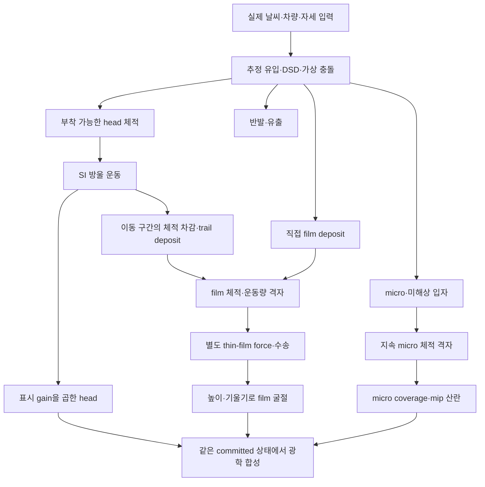

# RainFX 프리뷰별 연결·표현·평가 범위

**현재 모드 변경:** [deposit+drying](RAINFX_PRODUCT_DEPOSIT_BASELINE.md)이 같은 P0
제품 경로에서 선택 film 수송을 제외했다. 방울/경로/필드 마름은 유지한다. 아래 과거
수송·관성 설명은 이전 통합 경로에 해당하며, 현재 film은 제자리 reservoir다.

**후속 구현:** [통합 필드 lifecycle](RAINFX_PRODUCT_FIELD_LIFECYCLE.md)이 현재 s282에
field 증발/micro→film을 연결했다. 아래 §3의 누락과4592 통계는 **수정 전 감사 기록**이다.
현재 연결은 로컬 검증 완료·실제 CSP 미검증이다.32Hz 표시와 배율 불일치는 아직 남아 있다.

최종 환경별 조합과 실제 시각 목표: [사용자 영상 기준](RAINFX_TARGET_SCENES.md).
현재 기능 목록만으로 이 세 장면을 재현할 수 있다고 판정하지 않는다.

2026-10-25. 코드 기준 설명이며 새 게임 시험이나 런타임 수정이 아니다.
**물 원장이 맞는 것, 각 효과가 연결된 것, 화면이 자연스러운 것은 서로 다른 판정이다.**
현재의 계단 운동·크기 불일치·필드 누적을 최종 품질로 승인하지 않는다.

## 1. 어느 경로를 보고 있는가

|UI/경로|물방울|수막·흐름과의 관계|평가 범위|
|---|---|---|---|
|P1 SI motion만|기존 슬롯 생성/수명에 새 SI 운동 적용|새 물리 유입·필름 전체가 연결된 상태가 아님|크기별 고착/이동·가속 반응, 표시 gain 독립성|
|P1+P2 birth|실제 입력 기반 추정 DSD·입사·부착·반발·micro/film 배정|P3 OFF이면 필름 몫은 예비 재고/원장이고 완전한 시각 표현이 아님|생성·운동·물량; 완성된 비 전체의 외관은 평가 불가|
|P1+P2+P3|같은 이벤트와 동일 generation의 old→new 구간|head에서 차감한 trail + 충돌의 직접 deposit을 같은 공간장에 합침. 필드 증발/micro 전환 있음|연결 후보. 필드 자체의 능동 배수는 OFF이면 없음|
|위 경로+P4|P1/P2의 부착 방울|연결된 물량을 받지만 별도 coarse thin-film 법칙으로 움직임. 이전 준정상 속도 모델과 CFL 제한 사용|방울과 동일 속도·형상을 기대하면 안 됨. 유동 타당성 별도 미완료|
|위 경로+P4b|free slot으로 고임 일부 반환|제한된 고임→방울 전달 추가. 반환 방울은 정지 상태로 시작|양방향 연결 일부. 일반적인 모든 방울의 film 재흡수가 아님|
|s126 등 독립 GPU probe/후기 private interval|시험마다 synthetic stock/선택된 실제 입력 사용|특정 헤더·연산·수송 계약 시험.20µm 시험 수막을 쓴 경우도 있음|그 장면의 외관을 최종 RainFX로 판정하지 않음|
|**현재 continuous physical preview**|실제 연속 입력, 기본32Hz의 새 birth·SI 운동|공유 이벤트·head trail·같은 committed bank의 film/micro. 현재는 제자리 deposit+drying. merge/pool/능동 film 수송 OFF|기본 실제 입력 후보. 시각 결함을 지적해도 됨. 능동 sheet 완성으로 판단하지 않음|

현재 s282가 정상 출력 중이면 기존 업데이트 대신 product state/meta/film을 렌더한다.
P1/P2/P3 checkbox를 추가로 켜야 완성되는 구조가 아니다. 다만 표시 계수·film optics·
debug 설정 일부는 기존 UI 값을 공유한다. 예전 프리뷰의 기능 설명을 현재 경로에
그대로 적용하지 않는다. 단독 probe의 수치 통과도 위 통합 후보의 시각적 통과가 아니다.

## 2. 현재 s282에서 실제로 연결된 것



따라서 완전히 독립된 비를 두 번 생성한 것은 아니다. 하지만 **모든 필름이 화면에
보이는 방울 한 개의 뒤에 생기는 것도 아니다.** 충돌 물은 head/film/micro/반발로
나뉜다. 작은 입자는 head 없이 micro로 들어가고, 슬롯이 이미 차 있으면 새 부착 몫이
미해상 deposit으로 들어갈 수 있다. 한 슬롯의 bounded sampler가 처리하지 못한
추정 유입도 continuum으로 배정한다. 기존에 쌓인 물은 head가 사라져도 남는다.

head→trail은 동일 방울 이동 구간으로 계산하고 체적을 head에서 차감한다. 반면 film
격자는 이후 자기 운동량·두께·점성·중력·공기 전단에 따라 수송된다. 같은 외력 입력을
참조해도 방울의 pinning/항력 운동과 film의 운동 법칙·속도가 같지는 않다.
현재 film 모델은 미세한 자유표면·접촉선·메니스커스를 해석하는 완성 유체 모델이 아니다.

## 3. 현재 통합에서 빠진 P3 기능 — 중요한 제한

예전 `rain_film.lua`→`rainFilmResolve.hlsl`은 micro가 임계 높이를 넘으면 film으로
옮기고, film/micro의 증발을 계산한다. **현재 s282의 s167 source cell→s264 transport→
s267 commit 경로에는 필드 증발과 micro→film 전환이 없다.** source는 micro에 새
물을 더하고, transport는 film을 수송한다. head 자체의 증발은 별도로 존재한다.

또한 s282에서는 merge/pool이 꺼져 있어 film을 head로 되돌리지 않는다. micro는
그 자리에 계속 쌓일 수 있으며, film도 강우 공급·배수의 불균형으로 누적될 수 있다.
이 상태를 날씨·건조까지 완성된 모델로 평가하면 안 된다. 이 누락은 필수 통합 항목이며,
추가 수송 정밀도 연구보다 먼저 복구해야 한다. 보존 원장의 통과는 누락된 물리 과정을
검출하지 못한다. 증발시키지 않은 물을 재고로 계속 보유하는 것도 수치적으로는 보존된다.

기존 실제4592의 **직전 유효 stock**을 재해석한 결과:

|필드|체적|양수 셀 두께 p50 /p95 /p99|최대 두께|
|---|---:|---:|---:|
|film|645.29mm³|15.07 /36.01 /56.51µm|1419.05µm|
|micro|3543.98mm³|72.69 /243.47 /353.84µm|636.37µm|

이는 최근 한 상태의 field 통계이며 사용자가 이전에 본 모든 화면의 원인 증명은 아니다.
최대 film은 국소 고임이고 전체 필름이1.4mm라는 뜻이 아니다. 다만 micro가 상당히
누적돼 있다는 실자료다. 화면 크기·카메라 투영은 이 파일만으로 측정할 수 없다.
증거: `diagnostics/2026-10-25/preview_visual_contract/retained_field_stats.json`.

## 4. 5px 방울과 큰 수막이 공존하는 이유

### 4.1 표시 크기는 현재 head만 줄인다

`realvisor.lua`의 현재 기본값 조합:

```text
Display diameter gain =0.793700526
P2 display scale      =0.40
product head gain     =0.317480210
```

즉 같은 투영 조건에서 물리 접촉 footprint보다 head의 표시 직경을 약3.15배 작게
그린다. 화면 head가5px라면 물리 footprint의 명목 투영은 약15.75px일 수 있다.
실제 설정·형상·threshold·원근에 따라 달라지는 예시이며, 현재 사용자 설정값은 아니다.

trail 폭, 충돌 퍼짐, 물량, film 면적은 이 gain을 사용하지 않는다. 이는 물리와 표시의
독립성을 지키지만, **전체 물 표현의 시각적 비율은 아직 맞추지 않았다는 뜻**이다.
이 기본 gain만으로 수만 배 면적을 설명할 수는 없다. 나머지 누적·커널·optics를
구분해야 한다. 물리 크기를 다시 임의 축소해 맞추는 것도 해결책이 아니다.

### 4.2 넓이가 head 직경만으로 정해지지 않는다

- 충돌 deposit은 부착 후 남은 head만이 아니라 입사 물량과 퍼짐 계수를 사용한다.
  퍼짐 beta는1–6 범위여서 작은 잔류 head보다 넓을 수 있다.
- trail은 물리 접촉 폭과 전단 확장으로 배정한다. 표시용 작은 head와 폭이 같지 않다.
- field는1024×256, kernel support는 최소1셀이다. 미세 footprint도 격자에서 번진다.
  셀 폭은 UV 기준4개의4096-atlas texel이며 실제 mm는 위치별 Jacobian으로 달라진다.
- 많은 충돌과 이전 시간의 경로가 겹쳐 넓어진다. micro에는 보이는 head가 없는 공급도 있다.

### 4.3 굴절 모양은 물의 footprint 자체가 아니다

현재 광학은 h=V/area에서 film 높이를 얻고, 이웃 셀 높이 차로 기울기를 구한다.
별도 optical gain·카메라 거리·최대 screen offset으로 배경을 이동시킨다. 기본 최대
offset은24px다. head의 구슬 렌즈와 film의 small-prism 근사는 같은 표면을 다중 계면으로
추적하는 하나의 렌즈 모델이 아니다. coarse 높이 기울기·보간·누적 봉우리는 넓은
굴절 덩어리를 만들 수 있다. 물량 보존만으로 이 굴절 형상이 자연스럽다고 할 수 없다.

## 5. 진단 색과 정상 광학을 구분

|P3 view|의미|잘못 해석하면 안 되는 것|
|---|---|---|
|0|정상 film/micro 광학|표시 크기·굴절·흐름 품질을 평가할 대상|
|1/2|film/micro의 µm 높이 로그 색상|개별 방울 실루엣이나 실제 불투명도 아님|
|3|광학 coverage|액체 면적 비율을 실측한 지도 아님|
|4|최근 pool 반환 표시|전체 재고나 현재 반환 방울 크기 아님. s282는 pool OFF라 의미 제한|
|5/6|R film, G 표시 head, B micro|자주색은 film+micro이며 거대한 단일 방울이 아님|

R/B는 log2(1+hµm)/log2(1001)로 표시한다. 얇은 물도 넓고 밝게 보일 수 있다.
view5는 물이0이어도 mesh 전체에 alpha.85를 내므로 넓은 자주/검은 바탕과 배경이
섞인다. view6는 이 pass의 배경 투과를 없애지만 이후 visor optics는 남는다.
WF debug는 별도 설정이다. 이전 영상의 UI 모드가 불명확하면 정확한 색 계약을
단정하지 않는다. 정상 view0에서도 같은 큰 덩어리가 보이면 실제 품질 문제로 기록한다.

## 6. 32Hz 운동은 현재 어떻게 표시되는가

s282는31.25ms 입력을 한 물리 구간으로 묶는다. solver 안의8개 film substep은
안정성과 수송 계산용이며, head가 렌더 프레임마다8번 부드럽게 표시된다는 뜻이 아니다.
광학은 최신 완료 bank를 프레임마다 복사하지만 **이전·현재 head 위치 보간이 없다**.
완료 위치를 유지하다 다음 위치로 바뀌는 표시다. 실행이 몰리면 중간 계산 위치를
보여 주지 못하고 건너뛸 수도 있다. readback 지연을 전부 화면 지연으로 환산해서도 안 된다:
광학 선택은 최신 GPU receipt를 사용하며 CPU 승인 serial만 따라가는 것은 아니다.

따라서 사용자가 관찰한 낮은 운동 품질은 충분히 지적 가능한 현재 구현 결함이다.
32Hz는 비용상 선택이었고 최종 시각 품질 요구가 아니다. 그대로 최종 버전에 넣는다면
같은 계단 운동이 남는다. 높은 physics Hz만으로 해결을 보장하지도 않는다.

최소 장면 경로에는 렌더 갱신과 물리 갱신을 구분한 연속 표시가 필요하다. 보간은
같은 generation·지원 영역에서만 하고 birth/death/exit를 가로질러 섞지 않아야 한다.
head만 앞당기고 trail을 뒤에 두면 다시 분리되므로 표시 endpoint와 deposit 표현의
시간도 함께 맞춰야 한다. 이 장면 품질을 만족하기 전32Hz를 고정 요구로 유지하지 않는다.

최근 추가된128-walk 상한의 마지막 유효 위치 보존은 별도 근사다. 매우 빠른 방울의
이동거리를 줄일 수 있으며, 보간 부재를 해결하지는 않는다. 둘을 분리해 평가한다.

## 7. 어떤 지적을 지금 해도 되는가 / 다음 구현 계약

- **지금 바로 품질 결함으로 평가:** 정상 optics의 거대한 굴절 덩어리, 계단 운동,
  head/trail 간격·폭 불일치, 거칠고 꺾인 선, 비가 그친 후 남는 과도한 필드.
  “프리뷰이므로 정상”이나 “보존 통과했으므로 맞다”로 유보하지 않는다.
- **미완료 기능으로 표시:** s282의 field 증발·micro 전환은 후속 구현에서 연결됐으나
  CSP 미검증이다. pool/merge OFF,
  transient impact/개별 child splash의 미완성. 최종 물 표현으로 승인하지 않는다.
- **분리해서 봐야 할 것:** debug 색·배경 합성, 표시 gain, 과거 단독 probe의 시험 재고.
  이를 정상 광학과 혼동해 물리 크기를 역추정하지 않는다.

최소 통합 경로는 물리 모델을 버리지 않고, 연결한 field 마름/micro 전환을 실제로 검증하고,
head와 물길의 **표현 배율·시간 계약**을 명시해야 한다. 표시 보정은 물리와 독립성을
유지하되 head만 작게 만든 현재 시각 불균형을 해결해야 한다. 한 장면에서 입력→상태→
전달→표시가 연결된 화면을 보고, 그 뒤 선택 수송 모델의 필요와 비용을 판단한다.

## 코드 근거

- `realvisor.lua`: product 경로 선택, head gain, P3 texture 및 optics uniforms.
- `docs/runtime/s282/rain_product_visual.lua`: 같은 bank의 state/meta/film 선택,
  h=V/area 변환. 위치 보간 없음.
- `shaders/rainBirthEvent.hlsl`, `shaders/rainFilmDescriptor.hlsl`: 공급 분할과 경로 전달.
- `rain_film.lua`, `shaders/rainFilmResolve.hlsl`: 예전 P3 필드 증발·micro 전환.
- `docs/prototypes/s167/s167_sources.lua`, `s264/s264_coupled.lua`, `s267/s267_joint.lua`:
  현재 source/film transport/micro commit. 위 P3 두 과정은 연결되지 않음.
- `shaders/rainVisorDynamicDrop.hlsl`: rainPhysicalFilm의 높이·gradient·debug·광학.
