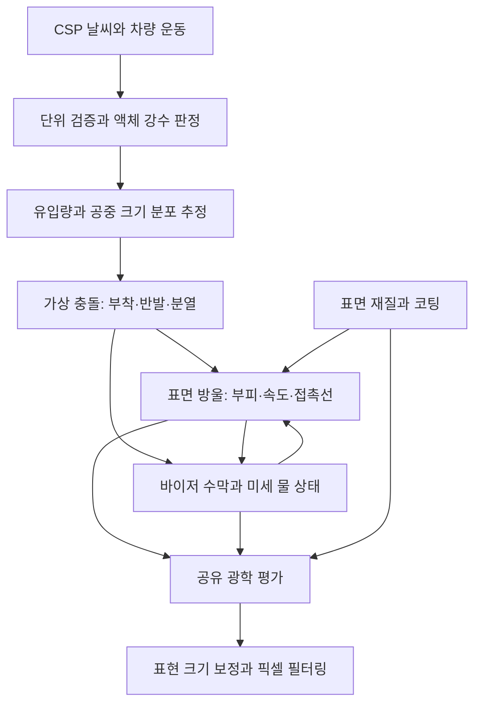

# RainFX s73 — 날씨·물방울·물리 모델 리팩토링 설계

> 초기 설계 보존 문서. 2026-10-25의 현재 구현 순서·최소 제품 범위는
> [목표 복귀 평가](RAINFX_PRODUCT_REFOCUS_2026-10-25.md)를 따른다.
> 아래 작성 당시 상태와 이후 실제 구현·채택 상태를 혼동하지 않는다.

Date: 2026-10-14. Status: ACTIVE — 설계 및 현재 소스 감사 완료. 아래 모델은 아직 런타임에 구현하지 않았다.

## 1. 결정과 적용 범위

**물의 부피를 기준 상태로 삼고, 질량·접촉 크기·이동·수막·광학 효과를 거기서 파생한다. 표현용 크기 계수는 최종 래스터화에만 적용한다.**

이번 요청은 설계 작업이다. 현재 동작하는 물리식, 사용자가 조정한 설정, KN5 및 텍스처는 변경하지 않았다. G-force 충돌과 메모리 누수는 사용자가 해결을 확인한 상태로 유지한다. s72의 트레일 직경 ×3은 구현된 임시 반응 보정이다. 새 물리 모델에서는 이 값을 물리 직경으로 가져오지 않고 폐기한다.

**사용자 범위 조정(s74, 2026-10-14):** 설계까지의 레거시는 Git 커밋 `0c092e0`에 보존되었다. 구현 브랜치는 `codex/rainfx-physics-weather`다. 새 모델의 기본 구현에서는 **Smear와 legacy local impact film을 제외**한다. 물리적 충돌·기본 flow·trail/rivulet/sheet의 표현력을 먼저 검증하고, 추가 보정의 필요성은 이후 판단한다. Smear는 제거 후보이며 아직 최종 삭제를 결정한 것은 아니다. 상세 범위는 `RAINFX_S74_CORE_IMPLEMENTATION_SCOPE.md`를 따른다.

구현 목표는 다음과 같다.

- 날씨는 유입·건조·상변화의 입력, 바이저의 물은 독립적인 지속 상태로 관리한다.
- 공중 빗방울의 체적 등가 직경, 부착 후 접촉 직경, 화면상 직경을 구분한다.
- 이슬/미세 방울, 고착 방울, 이동 방울, 리뷸릿, 시트, 충돌 비산을 같은 물의 서로 다른 상태로 표현한다.
- 기존 GPU 슬롯·스윕·희소 타일·4:1 이력과 경계 처리를 활용한다. 전면 유체 해석이나 전체 방울 쌍 탐색은 도입하지 않는다.
- 실제 CSP 신호로 알 수 없는 대기 DSD, 국소 공기 흐름, 바이저 온도는 **추정값과 신뢰도**로 표시한다. 추정치를 관측값처럼 취급하지 않는다.



## 2. 현재 소스에서 확인된 문제

감사 기준은 `docs/diagnostics/2026-10-14/s73/baseline/`이다. 현재 소스는 s72 전달 SHA와 다르며, 사용자의 새 mm 보정을 포함한다. 감사 도구는 읽기와 진단 산출물 작성만 한다.

| 경로/함수 | 현재 사실 | 리팩토링 결정 |
|---|---|---|
| `realvisor.lua`: `RAIN_GPU_STATE_PHYSICAL_DIAMETER_UV_PER_MM` | **6/4096 = 0.00146484375**로 수정됨. 반경 인코더와 merge 상한도 이 설정의 절반을 사용 | 수정 사항 인정. 전역 상수를 실제 KN5 Jacobian과 분리한 호환 인코더로 제한 |
| `rain_surface.lua:unit`, `rainSurfaceMetric.hlsl` | m/reference = 0.001/ref. 물리 길이를 레거시 reference로 변환하는 계층이 있음 | SI 계산은 이 reference에 의존하지 않게 변경. UV 이동은 실제 dP/dU, dP/dV로 변환 |
| `rainStateBirthDiameterMM` | wetness/water 인자를 받지만 함수 본문은 intensity와 난수로 크기 결정 | 유입량과 DSD의 역할 분리. 이름만 전달되는 입력을 제거 |
| `rainStatePhysicalMassProfile`, `rainMergeMassProfile` | D³을 0.5–6 mm 범위에서 **1–9**로 압축한 값 | kg 또는 부피에서 유도한 실제 질량으로 통일 |
| `rainStateAirflowAccelerationWorld` | 같은 직경을 구의 질량으로 해석해 SI 항력 계산. Cd=0.47, 입사각 계수 사용 | 부착 방울 형상/노출의 항력 모델로 교체. 고착 판단과 같은 질량 사용 |
| `rainStateAdhesion` | 슬롯별 임계 0.285–0.305를 정규화 질량의 제곱근으로 나눔 | 접촉 폭·표면장력·접촉각 이력으로 N 단위 저항 계산 |
| `rainStateExternalForceWorld`, flow | 전체 가속도 ×0.03567788, flow ×0.1296, 이동 중 ×2.99 등 | 기본 g·차량 가속도는 SI 유지. 재질 이동 저항과 공력 노출 계수로 대체 |
| `rainStatePhysicalMaxSpeed` | 낙하 속도에서 가져온 크기 지수 0.67, D 하한 0.5 mm, reference/s 속도 상한 | 낙하와 표면 운동 분리. 표면 속도는 힘/저항으로 결정; 안전 상한은 별도 수치 안정 장치 |
| lifecycle | 비가 그치면 age 한도를 2초로 줄여 방울 삭제 | 증발·유출·흡수로 감소. 삭제된 물의 행선지 기록 |
| `rain_trails.lua:environment` | .65 intensity + .35 density, wetness는 이 공급 목표로 평활화 | 입사 체적 유량과 바이저 물 재고로 대체. track puddles 대입 금지 |
| `rainTrailDescriptor.hlsl` | core 직경과 다르게 **trail만 ×3**. 높이 0–1; 이력 max 합성 | mm/µm 기반 실제 접촉 크기와 수막. 체적 전달에는 add/보존 갱신, 광학 마스크만 max |
| `smearUpdate` | intensity × 상대풍속/REF; cameraLook 기반 facing | 기본 모델에서 제외. 물리 공급/노출은 별도 adapter와 바이저 법선으로 평가 |
| haze 전달 | 주로 rain scalar와 절차 패턴 | 미세 물/수막에 의한 산란과 온도 기반 응결을 구분 |

예: 현재 0.65 mm와 2.25 mm의 정규화 질량은 1.0055와 1.4175이다. 같은 액체의 구형 체적 등가 질량은 약 0.1435 mg와 5.9534 mg로 **41.48배** 차이 난다. 현재 모델에서는 그 차이가 약 1.41배로 압축된다. 바람 항력과 pinning이 같은 질량을 사용하지 않는 것이 크기별 반응 충돌의 직접적인 구조적 원인이다.

보정값 변경으로 reference/s가 나타내는 실속도도 달라진다. 현재 1 mm 속도 상한 0.4624 reference/s는 변환상 약 **0.3157 m/s**이다. 같은 값에 이전 ref=0.0029296875를 적용하면 0.1578 m/s이다. 이는 속도 상한의 단위 환산이며 실제 주행 속도 측정이 아니다. 기본 가속도·저항까지 함께 재검토해야 한다.

## 3. CSP 입력 계약

근거: 현재 저장된 `lib.lua`, `ac.StateSim`, `ac.ConditionsSet`, `ac.StateCar` 선언과 함수 설명. `ac.ConditionSet()` 및 `sim.WeatherType`은 이 SDK의 정확한 API 이름이 아니다.

| 필요한 입력 | 확인된 API/단위 | 사용처와 제한 |
|---|---|---|
| 순간 강수 | `sim.rainIntensity`, 0–1 | 유입량 추정. mm/h로 정의된 센서 값이 아님 |
| 트랙 젖음 | `sim.rainWetness`, 0–1 | 트랙 재질/스프레이 가능성의 보조 입력. 바이저 접촉 마찰에 바로 대입하지 않음 |
| 트랙 물웅덩이 | `sim.rainWater`, 0–1 취급 전 범위 검증 | 선택적 스프레이 추정. `water=1`만으로 바이저 시트 생성 금지 |
| 조건 구조 | **`sim.weatherConditions`** | sanity filter를 거친 `ac.ConditionsSet`, 우선 사용 |
| 원본 조건 | `ac.getConditionsSet()`, `ac.getConditionsSetTo(dst)` | 진단/대조용. `ac.ConditionsSet()`은 구조 생성자이므로 현재 날씨 조회 대신 쓰지 않음 |
| 습도 | `conditions.humidity` 또는 `ac.getAirHumidity(position)`, 0–1 | 증발·이슬점. 프레임마다 새 구조 생성하지 않음 |
| 기온 | `sim.ambientTemperature` / `conditions.temperatures.ambient`, °C | 물성·증발. 노면 온도는 바이저 온도가 아님 |
| 압력 | `conditions.pressure`, Pa / `ac.getAirPressure(position)`, **kPa** | 공기 밀도와 물성. fallback 단위 ×1000 필요 |
| 바람 | `sim.windVelocityKmh`, game-space vec2; `windSpeedKmh`, km/h | world (x,z) 변환과 /3.6. 기존 wind-axis 옵션은 로그로 방향 검증 후 이관 |
| 강수상 | `sim.weatherType`, `conditions.currentType/upcomingType/transition` | 액체/고체 구분과 전환. 크기·효과를 type별 고정 레시피로 지정하지 않음 |
| 차량 운동 | `car.velocity`, world m/s; `car.acceleration`, car-local G | 관성·상대 충돌 속도. G→m/s² 및 정지 상태 중력 포함 여부를 시험으로 확인 |
| 회전/국소 운동 | `car.angularVelocity`, `localAngularVelocity` | 필드는 존재하나 확인한 선언에 단위 설명이 부족함. 단위/좌표 검증 전 회전 항 비활성 |

권장 adapter: 매 프레임 같은 `sim`/조건 구조에서 스칼라를 읽고 유효성·범위를 검사한다. 유효한 **0은 결측값이 아니다**. nil/NaN/무한대만 fallback한다. raw/filtered 차이는 1 Hz 표본 로그로 관찰한다. API가 실제 앱 환경에서 빠져 있으면 명시적인 fallback 상태를 표시한다.

- `rainProbability`, `rainVariance`는 확인한 `ConditionsSet` 공개 필드에 없다. WeatherFX가 이미 조정한 순간 intensity에 확률/variance를 재곱하지 않는다.
- Snow 9–11, Sleet 12–14, Hail 32는 SDK enum으로 확인했다. 초기 액체 전용 모델에서 이 타입의 **신규 액체 강수는 0**으로 처리한다. sleet 혼합상은 후속 지원 항목이다.
- 타입 전환 시 liquid fraction을 current/upcoming의 `transition`으로 보간한다. enum 변경 시 전역 수막을 지우지 않는다. 기존 액체는 증발/배수에 따라 남는다.
- Clear/Fog 등에서 live controller가 intensity를 주면 타입만으로 막지 않는다. unknown type도 유효한 rain channel을 존중하고 진단 상태를 남긴다.
- 영하 액체/얼음은 이 단계의 해석 범위 밖이다. 온도로 기존 액체를 즉시 삭제하지 않는다. supercooled/freezing 상태를 표시하고 자동 응결·물성 외삽은 제한한다.
- 사용자 프로파일의 일부 `km/s` 표기는 SDK의 km/h와 구분한다. 테스트 입력은 제시된 숫자를 km/h 사례로 정규화하고 원문 단위가 불명확했음을 기록한다.

## 4. 크기·질량·UV·표현 단위

### 4.1 권위 있는 물리량

GPU 표면 상태의 기준은 **액체 부피 V**이다. 저장 시 mm³를 쓰면 소량 물의 정밀도를 확보하기 쉽다. 식에서 SI로 변환한다.

```text
V_m3 = V_mm3 × 1e-9
m_kg = rho_water × V_m3
D_eq_m = cbrt(6 V_m3 / pi)     # 같은 부피를 가진 구의 직경
```

부착 방울은 구가 아니다. 첫 단계는 접촉각 θ의 spherical cap 근사로 접촉 반경 a와 높이 z를 계산한다. 이는 준정적·국소 평면 근사이며, 강하게 변형된 이동 방울/큰 시트는 별도 형상으로 전환한다.

```text
t = tan(theta/2)
V = pi a³ t(3+t²)/6
a = cbrt(6V / (pi t(3+t²)))
z = a t
D_contact = 2a
```

θ=90°이면 접촉 직경은 등가 직경의 약 1.260배다. 충돌 직후 최대 퍼짐 직경은 다시 별개다. `airborne_D`, `D_eq`, `D_contact`, `impact_spread_D`를 같은 `diameter` 변수로 합치지 않는다. 접촉각·형상 계수는 작은 LUT로 계산하고 유효 범위를 제한한다.

20°C 순수 물의 초기 근사 물성은 rho≈998.2 kg/m³, mu≈1.002e-3 Pa·s, gamma≈0.0728 N/m. 온도별 물성은 프레임당 한 번 LUT로 평가한다. 코팅·오염의 접촉각과 히스테리시스는 별도 재질 파라미터다. [IAPWS 표면장력 규격](https://iapws.org/technical-guidance/release/Surf-H2O), [IAPWS 물성 규격 목록](https://iapws.org/release).

### 4.2 새 메쉬 보정과 실제 metric

사용자가 측정한 4096×1024의 **1 mm=6 px**는 기준 위치/방향의 UV 교정이다.

| 값 | 결과 |
|---|---:|
| U/mm | 0.00146484375 |
| V/mm, 이상적인 4:1 동일 texel 크기 | 0.005859375 |
| 레거시 반경 단위/mm | 0.000732421875 |
| 1024×256 이력의 기준 샘플/mm | 1.5 |

곡면·UV 스큐·국소 밀도에는 KN5의 Jacobian `J=[dP/dU,dP/dV]`를 사용한다. 위 전역 비율을 모든 위치의 실제 metric으로 대체하지 않는다. 이동/넓이/도달거리/수막 면적에는 최종 물리 transform의 J와 scale을 적용한다. UI Model Scale과 순수 표시 이동/G-force는 물리 표면 transform과 분리한다.

```text
world displacement = J_world × deltaUV
deltaUV = inverse(J_world^T J_world) J_world^T × tangent displacement_m
cell area = |dP/dU × dP/dV|_world × deltaU × deltaV
```

인접 triangle의 접평면 이동은 현재 `rainAdvance`의 경계 검증·운동량 운반을 유지한다. UV island를 가로질러 보간하거나 wrap하지 않는다. 원래 1 mm 이동 한계를 reference 상수로 표현했던 부분도 m로 바꾼다.

### 4.3 화면 크기 보정

`DISPLAY_DIAMETER_GAIN`은 head/micro/얇은 trail의 **래스터 footprint**만 조정한다. core radius, kg, 항력 면적, 접착력, 병합 거리, 충돌 We, trail 분류, 물 이동량·수막 두께는 이 값에 접근하지 않는다. shader 인터페이스에서 물리 uniform과 표시 uniform을 분리한다.

초기 표시 보정은 이전 승인 화면의 크기 분위수를 맞춘다. 예를 들어 등가 직경 1.15 mm, θ=90°의 접촉 직경 1.449 mm를 기존 0.65 mm footprint처럼 보이게 하려면 gain≈0.449다. 6 px/mm 기준 약 3.9 atlas px이다. **이는 초기 맞춤 예이며 전 분포의 권장 단일 계수로 확정한 값은 아니다.** 공중 D를 바꾸고 같은 단일 gain을 적용하면 전체 분포의 분위수는 자동으로 같아지지 않는다.

micro의 중심 간격/개수, 물 재고 및 크기 분포는 gain으로 변경하지 않는다. 픽셀보다 작은 물은 coverage/산란으로 해상도에 맞게 통합한다. 얇은 trail도 물리 폭과 렌더 support 폭을 별도로 전달한다. 큰 시트는 실제 수막 상태에서 나오며 head 보정으로 줄이지 않는다. 법선/굴절 세기는 픽셀 texel 수가 아니라 물리 높이와 metric gradient에서 유도한다. 출력용 gain이 축소한 형상은 시각적 근사임을 명시하고, 실제 높이를 보존한 필터링으로 날카로운 렌즈를 방지한다.

## 5. 대기 DSD와 유입량

### 5.1 식별 가능한 것과 알 수 없는 것

intensity/wetness/water/RH/wind만으로 실제 대기 크기 분포를 유일하게 복원할 수 없다. wetness·water는 과거 강수와 배수의 결과이고, RH는 지상 습도다. 이들을 직접 큰 방울 확률에 곱하면 마른 허리케인/젖은 이슬비 같은 사례에서 오판한다. 강한 바람을 곧 큰 방울로 해석하지 않는다. 열대 저기압 관측에서도 같은 강우율에 위치별 DSD 차이가 있다. [Nivar DSD 실측 연구](https://amt.copernicus.org/articles/15/6705/2022/index.html).

첫 구현은 **연속적인 DSD 추정 + 사용자/실측 override**다. 날씨 이름은 액체상 예외 처리에만 필수로 사용한다. 다음은 외삽 가능한 초기 게임 모델이며 기상학적 역산식이 아니다.

```text
i = liquidFraction × clamp(filteredIntensity, 0, 1)
q = smoothstep(0.015, 0.15, i)  # drizzle 성분에서 일반 성분으로
c = smoothstep(0.12, 0.60, i)   # 큰 꼬리 후보; convective 관측값이라는 뜻 아님
b = smoothstep(12, 30, ambientWind_ms) # 낙하 큰 꼬리 억제의 낮은 신뢰도 추정
wD = 1-q
wR = q(1-c)
wC = q c (1-b)
wW = q c b
P(D) = wD P_drizzle + wR P_general + wC P_tail + wW P_windrich
```

자동차 속도는 이 **대기 분포의 가중치에 넣지 않는다**. 속도에 따른 encounter bias, 충돌 분열, 잔류 방울 크기는 다음 단계에서 계산한다. 상기 숫자는 조정 가능한 초기 추정이고 별도 `DSD confidence=estimated`로 표시한다. 저강수 뇌우/허리케인을 정확히 구별할 수 있다고 주장하지 않는다. engine/사용자가 DSD를 제공하면 이 추정식보다 우선한다.

사용자의 직경 범위/출현 비율은 다음 seed를 만드는 제약과 시나리오로 보존한다.

| Seed | 낙하 범위 mm | 사용자가 제시한 대표값 mm | 작은/중간/큰 개수 비율 |
|---|---:|---:|---|
| drizzle | 0.1–0.5 | 0.25 | 90/10/0 |
| general | 0.5–4.5, 미세 성분 추가 가능 | 1.15 | 65/30/5 |
| tail | 0.5–6.3, 미세 성분 유지 | 2.25 | 55/35/10 |
| windrich | 0.3–4.0, 미세 성분 유지 | 1.55 | 75/23/2 |

각 seed의 S/M/L은 **해당 범위 내 quantile 그룹**으로 정의한다. drizzle의 중간 그룹을 general의 0.5–2 mm 그룹으로 그대로 가져오지 않는다. CDF는 64–128 bin, log D 위의 잘린 gamma/lognormal/triangular 근사 중 하나로 오프라인 검증 후 LUT에 둔다. 대표 직경이 mode, number mean, volume-weighted mean 중 무엇인지 UI/문서에 명시한다. 위 비율과 대표값을 동시에 참이라고 강제하지 않는다.

감사의 공통 bin 실험(.1–.5/.5–2/2–6.3 mm, log-triangular)은 이 함정을 보여 준다. 65/30/5의 number mean은 0.654 mm지만 큰 5%가 체적의 82.2%를 차지한다. 이 공통 bin은 **채택할 DSD가 아니다**. number histogram과 D³ 가중 체적 histogram을 함께 보고 범위·꼬리를 조정해야 한다. 작은 방울이 많은 표면을 만들면서도 수막에 공급되는 체적이 부족해지지 않도록 한다.

6 mm 부근은 큰 낙하 방울의 분열을 강화하는 범위로 둔다. 6.3 mm 관측 후보를 전부 잘라 버리지 않는다. 실제 안정 상한은 낙하/난류 조건에 따라 달라지므로 IEC의 정확한 문구·범위를 이번 설계의 검증된 규격 인용으로 사용하지 않았다. 표면에서 병합한 액체에는 공중 낙하 직경 상한을 적용하지 않는다.

### 5.2 물 유입량과 개수

SDK intensity는 물리 강우율이 아니다. `RAIN_RATE_AT_INTENSITY_1_MM_H`와 monotonic curve를 **관측/룩 교정값**으로 노출한다. 출발 가정 R(i)=R1·i^p, p=1.0으로 두고 실제 캡처로 교정한다. R1은 조사 전 임의의 실제 강우율로 확정하지 않는다. 이는 힘의 배율과 분리된 공급량 calibration이다.

```text
vertical water flux_m_s = R_mm_h / 3,600,000
N0 = flux_m_s / E_DSD[V(D) × terminalSpeed(D)]
arrival_i = N0 × P(D_i) × max(0, -dot(v_relative_i, n)) × area × exposure
```

terminalSpeed(D)는 낙하 전용 LUT다. sampler는 P(D)만이 아니라 입사 속도 가중 분포도 반영한다. 같은 강우율에서 방울이 커지면 개수가 자동으로 줄어 체적 공급을 보존한다. 기존 density scale/slot occupancy를 독립적으로 곱해 공급량을 다시 늘리지 않는다.

표면 노출·차체 차폐는 기존 KN5 재질/경계에 추가하는 낮은 해상도 static exposure와 차량 방향을 이용한다. 매 프레임 방울마다 raycast하지 않는다. 체적 유입을 먼저 분류하여 미세 방울은 continuum micro/film 저장소, 관찰 가능한 방울은 persistent slot로 배정한다. 4096 슬롯 포화 시 무한 대기나 즉시 재생성 루프를 만들지 않는다. 넘치는 공급은 미해상 물 저장소 또는 명시적인 유출로 기록하며 capacity saturation을 표시한다.

track spray는 기본 비활성의 별도 유량이다. `rainWater × speed`만으로 실제 앞차 비산을 확인할 수 없다. 후속으로 전방 차량 거리·상대 운동·노면 근접/차폐를 제한된 5–10 Hz 후보 평가에 넣고, 직접 API가 없으면 `estimated spray`로 표시한다. 지붕이 가려진 바이저에 trackWetness가 높다는 이유로 물을 만들지 않는다.

## 6. 가상 충돌과 표면 초기화

birth 시에만 추가 계산한다. 공중 방울은 별도 장기 파티클로 시뮬레이션하지 않는다.

```text
v_drop_world = wind_world - terminalSpeed(D) × worldUp
v_surface = vehicleVelocity + verifiedRotationVelocityAtVisor
v_relative = v_drop_world - v_surface
v_n = max(0, -dot(v_relative, normal_outward))
v_t = tangentProjection(v_relative)
We_n = rho × v_n² × D / gamma
Re_n = rho × v_n × D / mu
Oh = mu / sqrt(rho gamma D)
```

287 km/h는 79.72 m/s지만 이를 모든 방울의 법선 충돌 속도로 사용하지 않는다. 국소 법선·차폐·차체 공기 흐름에 따라 실효 충돌 속도가 달라진다. 바람속도와 차량속도를 다시 더해 중복 반영하지 않는다.

충돌의 deposition/rebound/splash는 액체 관성·점성·표면장력뿐 아니라 젖음성과 주변 기체의 영향도 받는다. 단일 전역 `We>상수`를 보편적인 splash 법칙으로 만들지 않는다. [Josserand & Thoroddsen, Drop Impact on a Solid Surface](https://doi.org/10.1146/annurev-fluid-122414-034401).

구현 근사는 `logWe × wet/dry × material` 작은 LUT로 beta(퍼짐 비율), 잔류 fraction, splash fraction, tangent impulse fraction을 반환한다. Re/Oh의 온도 변화는 낮은 차수 보정으로 넣는다. LUT 범위 밖의 고속은 측정되지 않은 extrapolation으로 표시하며 보수적인 포화/분열 근사를 사용한다.

```text
V_air = V_attached + V_film + V_children + V_bounce_or_runoff
sum(fractions) = 1, each fraction >= 0
initial momentum <= deposited share of incoming impulse
```

큰 에너지의 충돌이 곧 큰 표면 방울은 아니다. 퍼짐 후 후퇴, 분열, 반발로 잔류 체적/접촉 크기가 작아질 수 있다. splash은 바이저 **접평면**에서 퍼지고 높이/관측 투영만 광학적으로 표현한다. 바닥을 비스듬히 본 타원 sprite를 전체 바이저에 합성하지 않는다.

초기에는 실제 child slot 생성 없이 분열 fraction을 국소 micro/film과 유출로 분배한다. 이후 필요할 때 birth당 최대 1–2개의 child, 전체 frame event cap을 허용한다. 동일 generation에 이벤트는 한 번만 소비한다. material/공급 바뀔 때 기존 방울을 강제 respawn시키지 않는다.

## 7. 표면 운동 모델

### 7.1 접착력·고착

저속 고착/슬라이딩 시작의 근사 기준은 Furmidge 형태다.

```text
F_pin_N = k × gamma × contactWidth_m × (cos(theta_R) - cos(theta_A))
```

여기서 θR≤θA, k는 접촉선 형상 계수다. 동일 재질이라도 θ와 hysteresis를 분리한다. 높은 접촉각만으로 낮은 고착력을 보장하지 않는다. [슬라이딩 방울의 힘을 측정한 연구](https://pmc.ncbi.nlm.nih.gov/articles/PMC11022544/), [Kinetic drop friction](https://www.nature.com/articles/s41467-023-40289-8).

theta/k/이동 저항은 코팅/유리/스티커의 material atlas에서 얻는다. 현재 `coat adhesion ×0.55` 및 모든 슬롯의 좁은 난수 임계는 대체한다. 기존 스티커 경계의 고임은 재질 불연속/접촉선 pinning으로 유지한다. 국소 random variation은 birth에서 고정하며 매 프레임 난수로 방향을 흔들지 않는다.

소형 방울이 gravity만으로 고착되는 것은 정상일 수 있다. 예를 들어 θ=90°, θR=70°, θA=110°, k=1의 **가상 재질**에서 0.65 mm 등가 방울의 무게/pinning은 0.0345, 2.25 mm는 0.4136이다. 이 숫자를 실제 바이저 재질로 주장하지 않는다. 방울을 움직이려고 임계만 낮추기 전에 실제 코팅의 hysteresis, 공력 노출 및 병합을 대조한다.

### 7.2 외력과 이동 저항

```text
F_drive = tangent(m × (gravity - verifiedVisorAcceleration) + F_air)
F_air ~= 0.5 rho_air Cd_attached(Re_air,shape) A_exposed |u_air| u_air
u_air = localWindAtVisor - surfaceVelocity - dropletSurfaceVelocity
```

공중 구의 Cd=0.47을 모든 부착 방울에 그대로 사용하지 않는다. 국소 차체/헬멧 boundary layer와 접촉 높이의 노출이 필요하다. 입사법선 gate는 유입에 쓰되, **스치며 흐르는 바람의 표면 전단을 0으로 만들지 않는다**. 저비용 모델은 물리적 노출/형상 LUT와 유효 local wind를 쓰고 전역 가속도 축소 계수를 제거한다.

고착 중에는 `|F_drive| <= F_pin`이면 접촉선이 유지된다. 이동 시작/정지에는 별도 hysteresis와 속도 epsilon을 둔다. 이동 중 저항은 측정 가능한 `F_contact_dynamic + c_viscous × v`, 필요할 때 quadratic 항으로 근사한다. **이동 저항은 static의 일정 0.297배로 확정하지 않는다.** semi-implicit/exponential drag 적분으로 작은 방울의 큰 가속도에서 안정성을 확보한다.

중력 g는 9.80665 m/s²를 사용한다. 차량 G는 로그로 기준·축·gravity 포함 여부를 먼저 검증하고 world 변환한다. visual G-force Motion의 화면 배치 변위를 실제 관성으로 넣지 않는다. 회전 추가 항은 단위 검증 후만 활성화한다.

Downward airflow는 사용자 지정 **흐름 방향 근사 옵션**으로 유지 가능하다. 자연 상태의 항력 법칙으로 설명하지 않는다. local wind field의 방향을 조정하며 중력·관성의 절대 크기는 변경하지 않도록 분리한다. 현재 world 중력 투영 방향과 lateral 성분 보존 원칙은 유지한다.

free-fall의 D^0.67을 표면 속도에 적용하는 상한은 제거한다. 정상 속도는 항력/접촉 저항 평형에서 나온다. geometry step cap은 미처 처리 못한 dt를 제한/이월하고 진단하며 방울 속도를 시각 계수로 줄이지 않는다. pause/replay/큰 dt에는 bounded catch-up을 적용하고 128-step 강제 소멸로 사라진 물도 유출 계정에 기록한다.

### 7.3 병합·흡수·경로

병합: `V=V1+V2`, tangent momentum `m1 v1+m2 v2`, 새 접촉각에서 footprint 재산출. 물리 contact distance로 검증하며 화면 gain은 사용하지 않는다. 2.5 mm 같은 old display cap으로 잉여 체적을 버리지 않는다. 큰 고임은 film/rivulet 저장소로 전달한다.

기존 CPU spatial grid 및 generation-pair GPU 검증을 유지한다. async snapshot은 후보 제공 역할만 한다. 현 상태의 거리/생존/세대 재검증을 통과해야 실행한다. 끌림은 먼 방울 간 가상 장거리 인력보다 접촉/연결된 wet path 영역으로 제한한다.

스티커에서 꺾이는 경로는 물리 방향 변화와 스윕 직선 연결을 별도로 진단한다. 저비용 1차 대안은 재질 전환 band를 **물리 접촉 폭**에 맞춰 보간하고 접평면 속도/저항을 시간 연속으로 갱신하는 것이다. 실제로 pin/unpin하는 현상을 무조건 곡선으로 지우지 않는다. 필요하면 곡률이 큰 segment에만 1개의 midpoint를 보존한다. 곡선 subdivision은 후보 타일/샘플 비용이 증가하므로 별도 gate로 둔다.

## 8. 수막·트레일과 물 재고

전역 `visorWet`은 필름 높이/coverage의 요약값이다. 직접 물을 생성하는 목표값이 아니다.

```text
V_total = sum(attached droplets) + integral(film height × physical cell area) + unresolved micro water
dV_total/dt = liquid rain deposition + verified/estimated spray + condensation - evaporation - runoff
```

tracker wetness/water는 이 식의 바이저 체적으로 넣지 않는다. 비가 그친 후 기존 물이 남는 것은 재고와 증발로 결정된다.

방울의 이동 segment에서 trail 높이 후보는 `Ca=mu v/gamma`, 접촉 곡률/반경, 재질, 기존 film을 이용해 계산한다. `h_candidate = C_material × R_contact × Ca^(2/3)`는 **현상 근사**로 사용하고, 실제 재질에 보정한다. 원래 LLD의 plate dip-coating 계수를 이동하는 유한 방울에 그대로 적용하지 않는다. [유한 방울의 film deposition 연구](https://arxiv.org/abs/2008.03058).

```text
V_deposit = min(V_drop_available, integral(h_candidate × sweptWidth × ds))
V_drop_new = V_drop_old - V_deposit + V_absorbed_from_path
```

가령 R=.5 mm, C=1일 때 v=.01/.1/1 m/s의 후보 높이는 약 1.33/6.19/28.72 µm다. 기존 0–1 height와 동일한 단위가 아니다. 이 값은 `audit.json`의 예시로, 코팅/흐름의 실제 보정 결과가 아니다. 얇은 방울이 긴 경로에 무제한 film을 남기는 것을 막는다.

| 상태 | 물리 조건 | 표현 |
|---|---|---|
| pinned/micro | 접촉선 저항이 힘을 지탱 | 방울·미세 산란. 움직이지 않으면 trail 없음 |
| thin moving trace | 작은 유효 deposit, 낮은 연결 수막 | 가는 흔적. 부족한 체적과 dewetting에서 비드 발생 |
| gravity rivulet | 지속 유입/병합, 낮은 전단, 두꺼운 국소 물 | 좁은 연속 흐름. film/rivulet 재고에서 공급 |
| shear sheet | 연결된 film이 있고 전단이 이를 넓게 운반 | 얇고 넓은 수막. density 또는 속도만으로 sheet 생성 금지 |
| high-shear drainage | 전단에 의한 이동/유출이 공급보다 큼 | 더 빨리 빠지고 얇아짐. 큰 고속 두꺼운 시트 강제 금지 |

film height는 체적 이동을 보존하도록 add/흡수/유출 갱신한다. `max`는 중복 광학 coverage·wipe에만 허용한다. 스윕 kernel은 물리 면적 적분이 1이 되도록 정규화한다. 경계 밖 kernel fraction은 runoff로 기록한다. 픽셀 적분/밴드 제한은 높이·coverage를 필터링하며 물리 체적은 별도 보존한다.

저해상도 이력에서 subtexel 실제 물을 표현하기 위해 `height`와 `coverage`를 구분한다. 같은 평균 체적이 얇게 퍼진 물인지 좁고 두꺼운 길인지가 굴절을 다르게 만든다. 셀 평균 높이 하나만으로 이를 같게 만드는 것을 피한다. 공통 four-tap gradient를 metric으로 평가하고 resolved height/coverage에서 광학 normal을 만든다.

wipe는 작은 방울/오염을 밀거나 흡수하는 접촉 효과다. 지나간 영역의 물을 삭제해서 clear mask를 만드는 것이 아니다. 물 제거량은 head/micro/film 간 전달 또는 유출로 계산한다. 새 기본 모델은 Smear 마스크나 그 wipe 억제 계약에 의존하지 않는다. 레거시 계약은 향후 Smear 재도입을 검토할 경우의 참고 자료로 보존한다.

deposit와 sweep은 **각 물리 프레임에 생성**한다. transport/evaporation만 별도 15–30 Hz로 실행할 수 있다. 기존 구간을 버리고 30 Hz마다 최신 구간만 그리면 다시 trail 간격이 벌어진다. 선형 exponential decay는 dt로 통합 가능하지만 비선형 이류·흡수·두께 변화가 단순 격프레임에서도 같다고 가정하지 않는다.

## 9. 주요 효과의 공통 판정과 합성

각 효과를 독립 intensity×speed 임계로 켜는 구조를 끝내고, 같은 상태의 다른 표현으로 평가한다. 지역별로 상태가 달라질 수 있으므로 바이저 전체에 하나의 mode를 적용하지 않는다.

| 효과 | 주요 입력 | 충돌 차단 규칙 |
|---|---|---|
| impact | birth normal impulse, material, existing film | birth event 전용; 같은 generation 재발사 금지. splash 중 head/trail 중복 체적 생성 금지 |
| flow | kg, 외력, contact line, local film | 실제 속도. intensity는 힘에 직접 곱하지 않음 |
| trail/rivulet/sheet | deposit volume, height, connectivity, shear | 상태 간 연속 보간. film 없는 빠른 방울은 sheet로 승격하지 않음 |
| smear (보류) | 기본 구현에서 입력·마스크·혼합 경로 제외 | flow/sheet/impact 검증 후 필요성 평가. 기본 물리·광학의 의존성 없음 |
| local impact film (배제) | legacy flux 기반 추가 수막 이펙트 | 새 모델에 이관하지 않음. birth의 물리적 충돌과 실제 국소 deposit은 유지 |
| haze / wet scattering | unresolved micro, coverage, material contamination | 위에 독립 흐린 full-screen layer를 중복 추가하지 않음 |
| condensation/dew | local RH, surface T와 dew point | rainIntensity가 0이어도 가능. high RH만으로 자동 발생시키지 않음 |
| micro pattern | 미세 유입/분열/응결 재고, 증발 | 개수·mass는 display gain과 분리. 오래된 비율로 무한 재생성 금지 |

Smear는 일반 차량 유리와 특수 바이저의 물 노이즈 표현 차이를 만들기 위한 추가 보정이었다. 기본 물리 효과가 충분하면 제거 가능하다는 사용자의 지침에 따라 첫 구현에서 제외한다. `RAINFX_SMEAR_MASK.md`의 fingerprint/R/G 혼합·wipe 억제 계약은 레거시 비교 및 향후 필요성 평가용이다. 새 기본 모델의 품질 gate로 요구하지 않는다. 이후 복구를 검토할 때도 clean water의 sheet를 smear로 오인하거나 물 재고를 늘리는 방법은 사용하지 않는다.

legacy local impact film도 별도 flux gate/canvas/opacity/wave layer 없이 배제한다. 새 충돌의 퍼짐·잔류 물은 물리적 입사 체적 원장에서 공급한다. core의 wind/공급/전단을 legacy `smearUpdate`에 의존시키지 않는다.

광학은 shared coverage/물리 gradient/탁도에서 한 번 결정한다. head→film→micro의 물리 중복을 제거한 뒤 오염/blur를 평가한다. 이미 합성된 물을 다시 깨끗한 scene copy와 섞어서 없애지 않는다. 기존 native occlusion·post-rain inner-optics capture 계약은 그대로 준수한다.

습도는 건조율과 응결의 증기압 차이에 반영한다. `j_evap = k_massTransfer × (rho_v_sat(T_surface) - rho_v_air)` 형태의 signed 근사를 쓰고 환기/풍속으로 k를 조정한다. RH=1이면 어떤 온도에서도 증발이 0이라고 처리하지 않는다. 표면이 더 뜨거우면 여전히 증발 가능하다. [NOAA의 이슬점 정의](https://www.weather.gov/arx/why_dewpoint_vs_humidity).

SDK에서 바이저 온도·바이저 내부 RH는 확인되지 않았다. 1차는 ambient T로 물성/외부 건조를 평가하고 자동 내부 응결은 기본 비활성으로 둔다. 선택적인 추정 surface temperature와 manual inner RH를 쓰려면 `estimated`를 명시한다. 태양광·운전자 열·풍속으로 온도 estimator를 만들더라도 실제 열모델 입력이 충분한지 별도 검증한다. 이슬은 birth impact를 발사하지 않고 미세 응결 저장소에서 성장/병합한다.

## 10. GPU 구조와 비용 설계

### 10.1 상태와 갱신 순서

기존 슬롯 수 4096, position/UV velocity RGBA32, meta age/generation, New Trail sparse resolve를 활용한다. 물리 meta는 다음처럼 버전 지정한다.

| 저장 | 제안 내용 |
|---|---|
| state RGBA32 | raw UV position + UV velocity. 식 내부에서 metric으로 m/s 변환 |
| meta row 0 RGBA32 | V_mm³, derived contact radius_mm, age_s, generation/status |
| meta row 1 RGBA32 | segment deposited V_mm³, deposited width_mm, physical regime/shape factor, impact event code |
| persistent film RGBA16 | 평균 등가 높이 µm, 액체 coverage, micro-equivalent height µm, wipe/optical clearance |

field 의미/정밀도는 film transport prototype에서 확정한다. 계수/각도/재질은 bake 및 per-frame uniform에서 읽어 row를 무조건 늘리지 않는다. 4096개의 meta 1행 추가는 ping-pong 합계 **128 KiB**다. 세대/status는 정수 정확도가 유지되는 RGBA32로 둔다. film RGBA16에서 µm를 직접 쓰면 m 단위 half-float subnormal 문제를 피할 수 있다. 매우 얇은 잔류층/큰 고임은 범위 테스트가 필요하다.

초기 파이프라인:

1. Adapter와 환경 scalar/LUT 준비. 기존 film은 직전 성공 프레임의 immutable 입력이다.
2. state pass: old V/footprint, 외력·접촉선·merge command 검증으로 새 위치/속도 계산.
3. meta commit: old/new segment에서 전달 체적과 새 V 계산, merge/death/birth 확정. 2행 shader의 반복 계산은 측정 후 small event row와 비교한다.
4. trail descriptor: **확정된 deposit V/width**와 같은 프레임 segment를 읽는다. 수막 공식/물리 상태를 다시 다른 기준으로 추정하지 않는다.
5. 기존 sparse resolve: kernel 정규화로 film에 deposit 추가. wipe는 독립 의미를 유지한다.
6. 필요 시 transport/건조, head/micro 광학, draw. 성공한 state/meta/film/descriptors를 함께 publish한다.

birth 충돌 함수는 state/meta에서 동일 seed/generation으로 pure evaluation하며 한 이벤트로 취급한다. 초기 구현의 흐름에서 merge survivor에 갱신된 V를 다음 frame까지 늦게 쓰는 오차는 측정하고, 같은 frame 물/impulse의 원장이 맞도록 commit 규칙을 정한다. **흡수는 초기 단계에서 비활성**으로 둔다. 여러 head가 같은 film cell을 읽고 각자 전량 가져가면 물이 복제되기 때문이다. 후속 흡수는 요청량 sparse gather→cell별 총요청으로 배분→head/film paired commit이 필요하며 추가 pass 비용을 별도 승인 gate로 둔다.

pending compile/capture에서는 일부 새 bank만 publish하지 않는다. 마지막 완전한 상태를 표시하고 이벤트를 이중 적용하지 않는다. 캔버스는 lifecycle당 한 번 배정하고 bounded buffers를 재사용한다. 기존 GC/누수 교정을 유지한다.

### 10.2 성능 평가

| 추가 항목 | 빈도/복잡도 | 평가와 우회 |
|---|---|---|
| 날씨/RH/물성 scalar | Lua O(1)/frame, 느린 값은 1–5 Hz | 매우 낮음. allocation-free 구조 재사용 |
| DSD·terminal speed LUT | birth당 O(1) | 낮음. 64–128 bin, 엔진 shader resource cap 확인 |
| impact We/Re/shape | birth당 O(1) | 낮음–중간. 고속 birth storm은 GPU timestamp로 측정 |
| contact/mass/drag | GPU O(N), 기존 pass 내 | 낮음–중간. 이중 행 계산·추가 sample 비용은 확인 필요 |
| 지속 film 질량 추가 | 기존 sparse resolve 내 | 비교적 낮음. 폭/수명 증가로 candidate 수가 커질 수 있음 |
| conservative film transport | 1024×256, 선택적 저빈도 | 중간. 추가 full-field pass는 prototype cost gate 후 도입 |
| paired film absorption | 요청/gather/commit | 중간–높음. 첫 구현 제외 |
| children/curved subdivision | event/segment budget 내 | 증가 가능. 초기 실제 children 제외, midpoint 선택적 |
| 완전 shallow-water/CFD/SPH, 모든 쌍 merge | 다수 pass/N² | 채택하지 않음 |

film은 초기에는 **deposit·evaporation·edge runoff**만 구현하고 능동 이류/흡수는 별도 단계로 둔다. 중력/전단 리뷸릿 표현은 움직이는 persistent drops와 deposited paths로 먼저 검증한다. 안정적인 conservative transport가 필요하면 finite-volume face flux(이웃 4셀)와 outgoing-flux limiter를 사용한다. 임의 backward texture advection은 체적 보존을 보장하지 않으므로 대체물로 쓰지 않는다. 고속 transport의 CFL/flux 제한 및 물리 dt 손실을 계량화한다.

DSD LUT를 추가하면 CSP/D3D sampler/texture 수 제한과 파라미터 동일키 규칙을 점검한다. 작은 배열 uniform 또는 기존 event/metadata 공간의 LUT를 대안으로 둔다. MRT/compute/UAV API는 이번 SDK 감사에서 확인하지 않았으므로 전제로 삼지 않는다.

수막이 넓어지면 kernel·tile candidates와 화면 굴절 비용이 커진다. O(N)이라는 이유만으로 무료라고 평가하지 않는다. unresolved micro는 continuum으로 합치고 zero-force pinned slots는 빠르게 종료하며 birth/merge/event에 frame cap을 둔다. 비의 입력량을 무시하는 frame skip으로 비용을 줄이지 않는다.

사용자 결과의 frame time 환산: 60% rain에서 79→59 FPS는 **12.66→16.95 ms, +4.29 ms**; 100%에서 75→45 FPS는 **13.33→22.22 ms, +8.89 ms**다. 앱 전체 차이이며 GPU만의 비용 측정이 아니다. 새 모델의 초기 gate는 같은 scene에서 전체 incremental ms가 이 기준보다 늘지 않도록 하고, 기존 목표(약 12 FPS 차이)의 ms 목표는 동일 baseline으로 다시 산출한다.

측정할 항목: physics/meta, merge 후보·commit, impact, descriptor, sparse candidate 수, resolve, birth mask, scene copy/optics, 최종 draw 각각의 GPU/CPU ms 및 p50/p95/p99. periodic 5 FPS/0-frame 재발, 10초 startup, shader compile stall, 메모리 peak도 별도 관찰한다. Lua callback 시간만으로 GPU 병목을 판정하지 않는다.

## 11. 단계별 이행과 설정/UI

| 단계 | 구현 내용 | 통과 조건 |
|---|---|---|
| P0 | 읽기 전용 adapter·단위 debug·calibration fixture | SDK field, wind axis, G 포함 여부, 물리 transform/metric 검증 |
| P1 | V 기반 meta, contact geometry, SI mass/forces/drag. 표시 gain 분리 | mesh/해상도/gain 변화에서 물리 결과 불변; 고착·이동 size 시험 |
| P2 | 연속 DSD·물 유입량·birth virtual impact | 체적 budget, DSD number/volume 분포, phase 전환, 임펄스 제한 |
| P3 | 질량 보존 deposit/micro/evaporation, 기본 물리 효과 gates | trail/head 시간 일치, sheet 실제 굴절, Smear/local impact film 없이 품질 검증 |
| P4 | 필요 시 film transport·흡수·제한 child/midpoint | 추가 pass의 ms/메모리 gate 및 conservation 통과 |

`PHYSICS_MODEL_VERSION`으로 새 상태/이력을 구분한다. 기존 튜닝을 덮어쓰지 않고 legacy profile을 보존한다. 상태 전환은 새 모델로 깨끗하게 초기화하며 같은 세션에서 구식 radius를 새 V로 재해석하지 않는다. user reset/재시작과 열/습윤 잔류 상태 초기화 정책을 명시한다.

UI 그룹:

- **Weather inputs**: raw/filtered I, trackWetness, trackWater, RH/T/p/wind, liquid fraction, estimated flux/DSD와 신뢰도.
- **Physical drops**: eq D/mm, contact D/mm, mass/mg, 속도 mm/s, 외력·pinning µN, contact angle/R/A, 재질별 이동 저항.
- **Film/effects**: 재고 µL, 높이 µm, coverage, 공급/증발/유출 µL/s, mode 기여, 경로 연결 상태.
- **Appearance**: 표시 직경 gain, optical gain/blur(광학 전용), texture filtering. 물리 UI 값과 별도.
- **Performance/debug**: active/capacity, event budget, skipped/capped work, segment 길이, pending 단계, per-stage ms. 기본 로그 off.

mm/s·D 배수 UI는 유지하되 `D`가 eq/contact/display 중 무엇인지 명시한다. `RAIN_NEW_TRAIL_MODEL_DIAMETER_SCALE`은 새 모델에 이관하지 않는다. 물리적으로 커진 방울을 작게 표시하고 싶으면 appearance gain으로 맞춘다. mass·adhesion·impact·trail thickness는 바뀐 실제 V에 따라 함께 평가한다.

## 12. 검증 시나리오와 남은 불확실성

다음은 사용자의 **시작 시점 관측값**이다. 프로파일을 프로젝트의 weather recipe로 매핑하지 않는다. 시간 변화/실제 weather controller 조건도 함께 재생한다.

| 관측 사례 | I / wet / water / RH / wind km/h | 핵심 검사 |
|---|---|---|
| Light Drizzle | .001/.005/.100/.600/5 | 많은 micro와 낮은 flux, 큰 film 강제 생성 금지 |
| Drizzle | .015/.040/.500/.700/10 | puddle이 커도 큰 낙하 방울로 바뀌지 않음 |
| Heavy Drizzle | .063/.125/1/.800/10 | 미세 분포의 높은 공급과 일반비 큰 꼬리 구분 |
| Light Rain | .032/.050/.300/.600/10 | 낮은 공급, 크기별 고착과 이동 |
| Rain | .090/.125/.600/.700/20 | mixed sizes, 얇은 경로와 wet material 반응 |
| Heavy Rain | .480/.600/1/.800/30 | 높은 flux, sheet는 실제 국소 재고 필요 |
| Light Thunderstorm | .070/.100/.200/.500/20 | 타입만으로 큰 drop/splash 강제 금지 |
| Thunderstorm | .130/.150/.400/.600/40 | 순간 입력 변화와 충돌 에너지 분리 |
| Heavy Thunderstorm | .290/.250/.830/.700/70 | 넓은 분포/강풍 + 작은 방울 지속 |
| Squalls | .013/.010/.196/.700/70 | 낮은 flux/큰 풍속에서 공급 없는 sheet 생성 방지 |
| Tornado | .212/.400/0/.800/100 | trackWater=0이어도 액체 강수 유입 |
| Hurricane | .690/.900/0/.900/120 | high flux + small-rich 분포, puddle 의존성 배제 |

추가 필수 시험:

1. clear→rain→clear, RH 높고 surface T>dew point, 차가운 surface의 선택적 dew; snow/sleet/hail 양수 rain 채널 및 타입 transition.
2. intensity=0/trackWater=1, intensity>0/trackWater=0, 건조 바이저/젖은 트랙, 지붕 차폐, 0 km/h·100·200·287 km/h, wind 반대/횡/순풍.
3. 동일 V/재질/외력에서 표시 gain .25/.5/1/2가 물리 hash·병합·We·유출량을 바꾸지 않는지 검사. atlas 2048×512/4096×1024도 물리 불변.
4. 0.1/.25/.65/1.15/2.25/4.5/6.3 mm equivalent size, theta 변화, sticker band, pinned/unpinning, 병합/분열 부피 및 운동량.
5. 표시 크기는 승인 사진과 head/micro의 screen diameter p10/p50/p90 비교. 6 px는 atlas 교정이고 camera screen px와 같다는 가정 금지.
6. 각 birth/merge/deposit 사건의 volume residual 목표 상대 오차 1e-4 이내(near-zero 절대 floor 별도), float film 적분은 10초 no-input closed test에서 1% 이내를 초기 gate로 설정. evaporation/runoff는 residual 대신 ledger로 기록.
7. 30/60/144 FPS·pause/replay에서 같은 elapsed time의 크기/재고/경로 비교. film 갱신 Hz를 줄인 경로 gap과 곡선 품질 검사.
8. 1024/4096 slots, 60/100% rain에서 10분 warm run, startup/compile, memory plateau/p99 frame time. 후보/이벤트 cap이 계속 포화하면 물량·품질 오차를 표시.

**아직 확정할 수 없는 값:** 실제 R(mm/h) calibration, 코팅/스티커 접촉각 이력과 동적 마찰, 국소 wind/shielding, 바이저 T/내부 RH, G 및 회전 단위, 고속 oblique impact LUT, CDF 분포의 실제 관측 적합도. 이를 물리 상수처럼 하드코딩하지 않고 관측/추정/표현 계수로 분리한다.

설계 대안은 정량적인 보존·단위 계약을 가진 reduced model이다. 실제 CFD 정확도를 보장하지 않는다. 이 문서의 low-cost 평가는 연산/자원 구조에 대한 판단이며 실제 게임 GPU ms 보장은 구현과 측정 후에 가능하다.

## 13. 산출물과 이번 검증

- `docs/tools/audit_s73_physics.py`: 감사 및 analytic fixture 생성. 기존 baseline 재실행 덮어쓰기 금지.
- `docs/diagnostics/2026-10-14/s73/baseline_manifest.json`: 수정 전 runtime/shaders/docs SHA·mtime.
- `docs/diagnostics/2026-10-14/s73/audit.json`: 새 교정값, kg/체적/contact/We 예제, number/volume mixture 비교, 수막 후보 높이.
- `against_s72_prechange.diff`: s72 작업 **시작 전** baseline과 현재 소스 비교. s72 최종 소스와의 diff로 오해하지 않는다. 최종본과의 차이는 전달 SHA 대조로 확인했다.
- 이번에는 CSP 실행·GPU shader 변경·인게임 성능 시험을 하지 않았다. 현재 runtime·설정·shader SHA 불변을 최종 검사한다.
