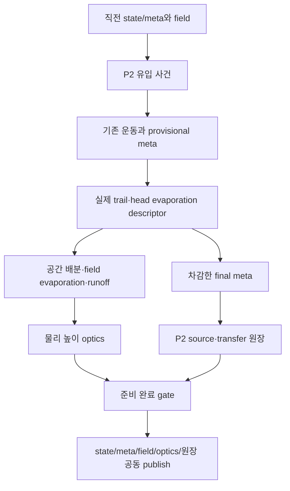

# RainFX s81 — P3 공간 물·보존되는 경로·물리 높이 광학 프리뷰

Date: 2026-10-15. Status: REFERENCE — 첫 P3 프리뷰 구현 및 WARP/LuaJIT 검증 완료. 제공된60% 게임 원장은 s82에서 통과; 전체 표현·장시간 정밀도·메모리 검증은 계속.

## 1. 기준과 범위

사용자 스탬프 **1ad4a95f48d7b683f38b9134bf6c202eb363780e**
(`P2 Conservation Passed`)에서 이어진다. 브랜치는 `codex/rainfx-physics-weather`다.
commit/push는 사용자가 한다. 기존 P1/P2 튜닝은 유지하고 P3는 기본 OFF다.

이번 프리뷰:

- 입사 위치의 film/micro/capacity 물을 공간장에 배정한다.
- 같은 프레임의 움직인 head에서 trail 체적을 차감하고 같은 공간장에 더한다.
- micro가 모이면 film으로 바꾸고, 실제 등가 높이를 직전 프레임의 wet impact 입력으로 쓴다.
- head/field 증발과 지원 경계 밖의 유출을 각각 기록한다.
- 수막 µm 높이와 metric gradient로 배경을 굴절시킨다.
- Smear, legacy local impact film, legacy trail/wipe/splash/micro/haze는 새 경로에 넣지 않는다.

**첫 공간장 프리뷰이지 완전한 P3/P4 물 흐름 완료는 아니다.**
필드 자체의 능동 이류, head의 field 재흡수, 실제 child 생성 및 별도 impact transient는 없다.
필드의 내부 물은 증발로 줄지만 바람/중력으로 경계까지 수송되지는 않는다.
입사·경로 커널이 지원 경계를 넘는 부분이 현재 runoff다.
움직이는 head와 그 뒤의 deposit이 기본 흐름을 만들며, 장시간 강우에서 필드가 쌓이는
현상은 이 범위의 한계다. 지속 강우의 완성된 drainage를 검증했다고 기록하지 않는다.
능동 conservative transport는 s73/s74의 P4 비용 gate에서 평가한다.

## 2. 물 재고와 물리 단위

`texture/RAIN_FILM/cells.dds`: 1024×256 RGBA32FLOAT.
2k×512의 실제 supported Jacobian을 2×2 셀로 합쳐 만든 static asset이다.

| 채널 | 의미 |
|---|---|
| R | scale1의 지원된 실제 셀 면적 /mm² |
| G | fine-cell 지원 coverage 0–1 |
| B | 면적으로 가중한 coating share |
| A | 지원 여부 |

면적 합은 .04028860096m²로 현재 P2 면적과 일치한다. 모델 scale²를 runtime에 적용한다.
전체 bake는 게임 로딩/프레임에서 다시 계산하지 않는다. geometry stamp를 대조하고,
cells DDS 하나를 최초 한 번 비동기 checksum으로 확인한다.
KN5 migration build에 `build_s81_film_cells.py`를 추가했다.

물 field는 inner1024×256 + halo16셀 → **1056×288 RGBA32FLOAT 두 bank**다.

| 채널 | 의미 |
|---|---|
| R | 현재 film 체적 /mm³ |
| G | 현재 unresolved micro 체적 /mm³ |
| B | 해당 셀의 누적 field evaporation /mm³ |
| A | 해당 셀의 누적 runoff /mm³ |

물리 field는 높이 또는 광학 opacity를 `max`로 합치지 않는다.
입사·trail 체적을 더하고 빠진 체적을 차감한다. 높이는 `V/area`에서 유도한다.
history loss 채널은 물이 모두 말라도 유지한다. 사후 residual 보정으로 물을 만들지 않는다.

## 3. head → trail 전달

provisional state/meta가 계산한 **old → current 같은 generation의 segment**를 쓴다.
리드백, 예측 중심 또는 CPU stamp queue를 사용하지 않는다.
pinned, birth, 퇴장 및 merge 중심 재배치에서 가상 선을 그리지 않는다.
merge로 V가 증가한 프레임은 최초 프리뷰에서 trail을 한 step 건너뛴다.
따라서 이 병합 경우의 연결 품질은 별도로 관찰해야 한다.

축소 모델:

```text
Ca = mu * speed_m_s / gamma
h_candidate_mm = C_material * contactRadius_mm * Ca^(2/3) * shearThin
width_mm = 2 * contactRadius_mm * (1 + widen * shear)
V_requested_mm3 = h_candidate_mm * width_mm * distance_mm
V_deposit = min(V_head, V_requested)
```

`C_bare=.35`, `C_coat=.05`는 **미측정 finite-drop 교정 시작값**이다.
LLD의 `Ca^(2/3)`는 제한적인 scaling 참고이며, plate coating 또는 실제 바이저의
검증된 전체 법칙으로 취급하지 않는다. slip/재질에 따라 다른 scaling도 가능하다.
[유한 방울의 film deposition 연구](https://arxiv.org/abs/2008.03058).

속도 하한은1mm/s, shear width gain은.50이다. 시간은 head가 실제로 적분한
최대.05s motion dt를 사용하고, evaporation/source는 실제 sim.dt를 사용한다.
기존 P1의 큰 dt motion 손실을 이번 단계에서 감추거나 변경하지 않았다.

metadata의 물리 contact radius를 재사용한다. 표시 gain, old trail diameter×3,
texel 기반 minimum radius, density/occupancy 값은 전달 식에 접근하지 않는다.
float32의 실제 차감값을 descriptor에 저장하고 그 값을 field에 넣는다.
미세 요청량이 head의 분해능 아래로 반올림되면 그만큼 새 film을 만들지 않는다.
완전히 물을 잃은 head는 같은 generation의 dead 상태로 retire한다.

## 4. 위치 배분·연속 경로·경계

각 source와 segment에 normalized separable tent kernel을 쓴다.
정수 support 폭은 격자 전체에서 partition of unity를 만족한다.
source는 점 커널, trail은 이동 segment를 따른 커널의 적분이다.
각 셀의 선 적분은 최대7개의 이차 구간을 Simpson 적분하므로
중간 경로를 이산 간격으로 찍지 않는다. field의 모든 적분값 합이 전달 체적과 일치한다.

support는 실제 mm footprint를 Jacobian으로 field cell에 투영해 정하고,
최소1셀/최대16셀은 sampling·작업량 제한이다. 물리 D·질량·접착력을 바꾸는 값이 아니다.
상한을 만난 descriptor 수는 P2 extended log의 `kernelCappedTotal`로 표시한다.
상한에서 물량은 보존되지만 퍼짐 footprint는 근사다. 광학 품질 gate에서 확인한다.

16셀 halo는 UV 가장자리의 커널 끝을 받아 runoff로 집계한다.
holes/unsupported cell도 유출로 분리한다. partial boundary cell은 지원 coverage만
배정하고 나머지는 runoff로 보낸다. 전체 커널을 작은 지원 면적에 몰아 높은 렌즈를 만들지 않는다.
경계의 손실은 이 coarse distribution의 근사이며 정확한 접촉선 runoff를 실측한 값은 아니다.

tile32×32, 96-slot word와 기존 sparse summary traversal을 재사용한다.
4096 전체 slot에 도달하고 기존 CPU384 stamp cap이 없다.
별도 bead/ripple 노이즈를 물 두께에 곱하지 않는다. 실제 운동의 급한 방향 전환과
coarse field sampling은 남으므로 모든 경로가 곡선으로 바뀐다고 주장하지 않는다.

## 5. micro·젖음·건조

micro는 fine 입자/분열의 **미해상 물 재고**다. 이번 출력은 실제 개별 micro 방울의
DSD/surface motion이 아니라 source-driven continuum scattering이다.
micro 등가 높이가20µm(bare), coating에 따라최대40µm를 넘으면 초과 물을 film으로 옮긴다.
이 임계값은 실측 coalescence 조건이 아닌 초기 교정값이다.

P2 impact는 **직전 성공 field**의 film+micro 등가 높이를 읽는다.
fully wet height20µm를 기준으로 기존 estimated dry/wet LUT를 연속 혼합한다.
같은 사건이 새로 만든 field를 다시 읽거나, track wetness/water를 바이저 물로 쓰지 않는다.
manual wet override는 진단 하한으로 유지한다. pinning/contact-angle wet feedback은 아직 추가하지 않았다.

evaporation은0°C 이상 액체 모델의 reduced estimate이며 다음 교정값을 쓴다:

```text
rate_um_s = dryRate * (1-RH) * saturationPressureRatio(T,20C)
            * (1 + .5*sqrt(localAir_m_s))
dryRate = .05 um/s
```

온도·습도·실제 상대풍에서 dry rate를 만들고, source 없이도 현재 물을 줄인다.
visor 온도/내부 RH/열전달/상변화 또는 condensation은 시뮬레이션하지 않는다.
head는 cap 표면 면적, field는 supported cell 면적에서 증발을 계산한다.
head loss는 float32 실제 차감량이며 field loss는 각 셀에 누적한다.
film의 coverage/ventilation 상세 실험값은 후속 교정이 필요하다.
운동/impact/deposition의 mu/rho/gamma는 **기존20°C 참조값**을 유지했다.

## 6. 물리 높이 광학과 mesh 가림

optics texture 두 bank는 inner1024×256 RGBA16FLOAT이며 R/G는 **film/micro µm 높이**다.
이는 물리 재고가 아닌 read-only 표시용 파생물이다. half-float 안전 범위60000µm로
광학 값만 제한하며 물리 V를 자르지 않는다.

field gradient를 실제 Jacobian에서 m/m slope로 변환하고,
small-prism deflection에 카메라→film 거리와 screen UV Jacobian을 적용한다.
`n≈1.333`은 물의 참조 광학 근사이고, temperature/wavelength별 full refraction 계산은 아니다.
물의 굴절률 참고: [IAPWS R9-97](https://iapws.org/public/documents/cMTlA/rindex.pdf).
`Film optical gain` 기본1과 screen displacement cap24px는 **광학 전용**이다.
head display gain은 field의 전달량·두께·classification에 영향을 주지 않는다.

micro height는 같은 field에서 continuum scattering mip으로 표현한다.
형상·산란 coverage는 광학 근사다. film은 head 아래로 합성하며 이미 head로
굴절한 ray를 film으로 다시 추적하는 다중 계면 ray tracer는 아니다.

기존 `txDynamicWaterTrail` slot을 재사용해 새로운 draw sampler를 추가하지 않았다.
field가0인 영역은 효과가 없고 기존 native depth rejection을 따른다.
투명 field는 opaque depth를 쓰지 않는다. E2/E3/coat/native mesh 정책은 변경하지 않았다.
debug1/2는 film/micro 높이 색상(범위0–1000µm log), debug3는 optical coverage다.
debug0이 정상 광학 출력이다.

## 7. 공동 게시와 원장

매 step:



meta는 provisional bank 외에 scratch 하나를 두고 성공한 publish에서 소유권을 교환한다.
field/optics는 double buffer다. 준비 실패11곳과 prepare 예외에서 기존 read bank를 유지한다.
reset은 세 개의 서로 다른 meta 소유자를 각1회 해제하고, texture 참조도 비운다.

P2 source budget은 P3에서 head evaporation, trail transfer, sampling cap count를
작은 추가 row에 기록한다. P2 OFF/P3 OFF 구조는 기존2-row blocks/4-row totals/8-float log를 유지한다.
P3 ON이면3/6/12로 바뀐다. 기존 P2 log의 `film-reserve`는 trail을 포함한 누적 배정량이며
**현재 field 물 재고와 같은 값이 아니다**.

실제 P3 물 원장:

```text
input = currentDrop + currentFilm + currentMicro
      + cumulativeBounce + cumulativeDropExit
      + cumulativeHeadEvap + cumulativeFieldEvap + cumulativeFieldRunoff
```

capacity water는 이미 field에 배정되므로 이 식에서 별도로 다시 빼지 않는다.
trailTransferred도 내부 이동이므로 loss로 빼지 않는다.

매 프레임의 필드 전체 합산은 하지 않는다. **Log P3 actual water budget을 누를 때만**
16×16 field reduction→5×2 coarse reduction→totals→16-float R32 readback을 실행한다.
현재 field와 같은 프레임의 published P2 budget을 함께 읽는다.
cell loss 누계는 float32이며 별도 per-cell compensation buffer는 없다.
장시간 오차는 게임 원장과 closed-field gate로 평가한다.
prepared epoch/frame 및 readback snapshot clock을 고정하고 stale callback은 버린다.

P3 toggle은 source/field/clock을 reset한다. 과거 P2 누계 reserve를 새 field에 풀지 않는다.
새로운 성공 사건만 한 번씩 배정한다. params/canvas/소형 asset은 재사용한다.

## 8. 비용과 검증

4096-slot의 추가 raw storage:

- descriptor .3125MiB, meta scratch .0625MiB.
- padded field 두 bank9.28125MiB.
- µm optics 두 bank4MiB, static cells4MiB.
- sparse tile/summary 약.1994MiB.
- 합 약**17.856MiB**, P2 extra rows 약1KiB 및 driver/shader overhead 제외.
- 수동 진단 buffers19296bytes는 첫 log 요청 때만 배정한다.

추가 steady GPU passes는 descriptor/meta/tiles/summary/field/optics **6개**다.
active source/trail만 sparse kernel을 평가한다. descriptor는 provisional radius를 재사용해
5행에서 cube root를 반복하지 않고, 전달량0이면 post-meta radius를 다시 계산하지 않는다.
정상 프레임에서 budget scan/readback 또는 CPU per-drop loop를 추가하지 않았다.
shader keys/type, samplers, async update는 기존 SDK 계약을 따른다.
실제 GPU ms, FPS, warm memory 및 startup latency는 아직 게임에서 측정하지 않았다.

검증:

- `check_s81_film_gpu.py`: `/Ges /WX` D3D11 WARP13개 검사.
  점/동일 point/다양한 직선·폭, halo·holes·partial coverage,4096 겹친 sources,
  실제 head 차감과 pin/birth/merge skip, reference codec invariance, head evaporation,
  multi-step P2/field loss book, 실제 wet impact,12초 무유입 건조.
- 4096 겹침의 source6.1440003mm³ 대비 오차 약2.35e-6mm³.
- paired source/field 원장 오차 약-2.98e-8mm³,12초 closed dry 오차 약-1.86e-9mm³.
- `check_s81_film_lens.py`: 전체 production shader에서 실제 굴절, 빈 영역 no ghost,
  visible P2 head의 P3 OFF bit identity, native 앞면 가림, 투명 field의 depth 미작성.
- `check_s81_film_binding.py`: 실제 Lua factory/main publish/reset12개 검사.
  준비 실패·이전 wet field·meta ownership/feedback·canvas reuse·clock·수동 snapshot·epoch 해제를 검사한다.
- `check_s81_legacy.py`: s80의 P2 GPU10개/Lua13개 검사를 별도 폴더에 재실행했다.

보고서: `diagnostics/2026-10-15/s81/`.
위 결과는 실제 게임의 화면 품질/비용 확인을 대신하지 않는다.

## 9. 설치와 첫 게임 gate

shader/texture/realvisor.lua는 기존 project 링크로 반영된다.
`rain_birth_gpu.lua`와 새 `rain_film.lua`는 마지막 설치 SHA를 확인하는 installer로 갱신한다.
**앱 reload가 필요하다.** preview 값은 아직 material settings에 영구 저장하지 않는다.

RainFX → Weather inputs and physical units (P0):

1. GPU heads/lifecycle mode3또는6을 유지하고 P1, P2, **Enable P3 conserved film preview**를 켠다.
2. 같은 낮60% 조건에서 정차와100–150km/h 직진을 관찰한다.
   일반 moving head와 trail 연결, 물을 잃는 head, 국소 film/micro 누적 및 굴절을 확인한다.
3. 각 상태에서 `Log P3 actual water budget`을0/15/30초에 기록한다.
   최초 진단 shader가 준비 중이면 잠시 뒤 버튼을 다시 누른다.
4. 필요하면 P3 view1/2로 실제 µm 높이를 캡처한 뒤0으로 복귀한다.
   정상 optics와 gain0의 비교는 물리 재고를 바꾸지 않는다.
5. 같은 장면에서 P1+P2와 P3 추가의 warm FPS/메모리를 비교한다.
   P3 toggle은 reset이므로 비슷한 경과 시간에서 비교하고, cold compile 구간은 분리한다.

현재의 한계를 먼저 알려야 하는 것은 **필드 내부의 능동 drainage가 아직 없다는 점**이다.
첫 gate는30–60초의 입사/경로/광학/원장·비용으로 평가하고,
지속 폭우에서 쌓인 field를 최종 장시간 물 흐름으로 해석하지 않는다.

## 10. 사용자 첫 게임 결과 (2026-10-15)

s82에서 제공된6개 원장, 정상/film µm 이미지, 두16초 영상을 검토했다.
최대15초 구간 상대 보존 오차2.04288e-5로 제공된60% 정차/직진 원장 gate는 통과했다.
P2=66/P3=65FPS는 약1FPS 측정 오차 내다. 실제 GC 후 최저 메모리와
head/trail 연결 품질은 미확정이며, 장시간 field float32 스트레스에서 추가 정밀도 문제가
확인됐다. 런타임 변경 없이 결과와 제한을 `RAINFX_S82_P3_GAME_REVIEW.md`에 기록했다.
