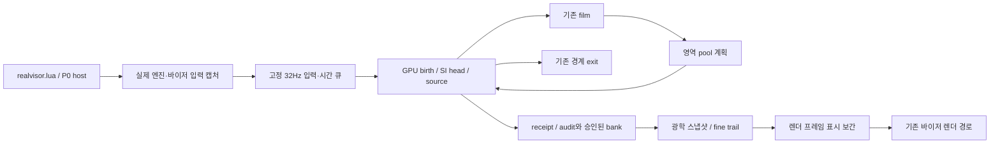

# 개발 구조와 검증

2026-10-25: 새 개발 방향은 [CSP 새 구현안](../RAINFX_CSP_REDESIGN.md)이다. 아래 기존
P0 구조 지도는 보존한 앱을 이해하기 위한 것이다. 그 모델·연구 승인 절차를 새 구현의
전제 조건으로 삼지 않는다. 기존 실험 도구는 보관본으로 정리됐다.

[현재 상태](CURRENT_STATUS.md) · [유지보수](MAINTENANCE.md)

## 구성 지도

| 위치 | 책임 |
| --- | --- |
| `realvisor.lua` | 앱 UI, 설정, KN5 로드·Transform, 카메라/렌더 hook, 기존 효과, P0 host 연결 |
| 루트 `rain_environment.lua`, `rain_birth_model.lua` | 날씨 해석·DSD 등 순수/공유 입력 모델 |
| `rain_physics_units.lua`, `rain_surface.lua` | 물리 단위·표면/메트릭 인터페이스 |
| `material_settings.lua`, `native_glass_*.lua`, `visor_optics.lua` | 재질 저장, native glass 상태, 캐시 geometry와 광학 |
| `shaders/` | 파일 HLSL. Lua 문자열에도 상당수 GPU 셰이더가 있으므로 여기만 수정하면 안 됨 |
| `texture/RAIN_GEOMETRY`, `RAIN_BIRTH`, `RAIN_FILM` | 오프라인 생성한 표면·입사·면적 데이터 |
| `texture/GLASS` | 유리·광학 매핑과 E1 geometry 자료 |
| `docs/runtime/s282/` | 현재 연속 제품 프리뷰의 host·owner·source 후처리·광학 소비자 |
| `docs/prototypes/`, `docs/probes/` | 연구 이력과 여전히 실행에 필요한 모듈이 혼재 |
| `docs/tools/` | 검사·자산 생성·native readback·Python 장면 비교. 다수 경로가 개발 PC에 묶임 |
| `docs/diagnostics/`, `docs/development/` | 증거 스냅샷·판정·노력 원장. 실행 구현과 구분 |

현재 제품 경로의 개념도:



실제 연결 확인은 `realvisor.lua`의 `s282ProductUI`에서 시작한다. host가 여러 s번호
모듈을 load/preload하고 pipeline이 graph를 감싼다. 현재 wrapper 순서:

```text
inventory → deposition → trace → field lifecycle → deposit-only
→ diagnostic policy → regional pool → accepted trail export
```

순서는 계약이다. 예를 들어 pool은 공통 sourceCell의 수량 차감을 확장하고,
trail exporter는 실제 사용한 source raster에서 이력을 얻는다. wrapper 하나를 바꾸면
원래 bind와 cached recipe가 같은 수정·순서·uniform을 유지하는지 검사한다.

## 물리·표시·소유권 계약

- 권위 수량은 mm³, 질량은 `volumeMM3 ×1e-9 ×rho` kg이다. 힘·속도 등은 SI다.
- 등가 낙하 직경, 접촉각 기반 표면 반경, 표시 크기는 다른 값이다.
  현재 메쉬의4096×1024 기준6px/mm 교정과 표현 배율을 섞지 않는다.
- `Display diameter gain`은 물리 힘·질량·입사·병합 판정에 들어가면 안 된다.
- 트랙 rainWetness/rainWater는 바이저에 저장된 물이 아니다. 현재 field 재고는 별도다.
- 입력 스냅샷·GPU 자원을 실행 중 임의 재사용/해제하지 않는다. 승인된 bank와 미완성
  candidate를 구분하고, read/write alias와 pending 반환을 처리한다.
- GPU `updateWithShader`의 준비 대기를 성공/완료로 취급하지 않는다. SDK sampler를
  중복 선언하지 않고 texture 수·포맷·치수·CSP 전달 방식까지 검사한다.
- 무한 큐·시간 부채 삭제·물 재고 삭제로 실패를 가리지 않는다. 물리 보존과 시각 품질은 별도다.

## 현재 유지하는 도구

| 종류 | 파일 |
| --- | --- |
| 기본 검사 | `check_installation.py`, `check_project.py` |
| 공유 Lua loader | `lua_runtime.py` |
| 영상 표본 보기 | `inspect_visor_video.py` |
| 모델/기하/광학 생성 | `kn5_assets.py`, `build_e1_housing_bvh.py`, `build_visor_optics_assets.py`, `bake_rain_surface.py` |
| 기존 birth/field bake | `build_s79_birth_assets.py`, `build_s81_film_cells.py` |

구형 install_s*.ps1, 단계별 패널/standalone 앱, 반복 WARP/대량 수치 실험 도구는
활성 트리에서 제거했다. 필요한 과거 원본은 복구 ZIP에서 동일 상대 경로로 찾는다.
신규 구현에 반드시 필요한 작은 검사는 실제 기능이 생길 때 추가하며, 단계별 앱을
계속 만들어 설치하는 방식은 사용하지 않는다.

## 개발 환경과 기본 명령

게임 실행은 CSP Lua 환경을 사용한다. Python 검사는 Python3.12 계열과 NumPy/Pillow,
Lupa LuaJIT2.1이 사용된다. Blender background bake에는 Blender의 mathutils 등이 필요하다.
영상 디코드 helper의 Windows native build는 VS2022 C++/Windows SDK를 전제로 한다.

```powershell
py -3.12 -m pip install numpy Pillow lupa
python docs/tools/check_installation.py --check-hashes
python docs/tools/check_project.py --syntax
```

`check_installation`은 핵심 파일과 현재 자산 manifest, `check_project`는 보존 의존성·
Python 구문·Lua 구문을 확인한다. 실제 CSP 실행·셰이더·외관·성능 검사가 아니다.
일반 Lupa 설치를 우선 사용하고 기존 오프라인 개발 환경의 cache-wheel fallback을
유지한다. 완전한 dependency lockfile/범용 bootstrap/CI는 아직 없다.

실행 의존성 목록은 `docs/development/runtime_dependencies.json`이다. 현재73개 Lua를
보수적으로 남겼으며 최소 의존성의 수학적 증명은 아니다. 파일을 추가·교체하면 manifest와
실제 load/preload 경로를 함께 갱신한다. 새 모델용 파일이 생겨도 옛 P0에 무조건 연결하지 않는다.

## 새 개발의 구현·평가 순서

[새 구현안](../RAINFX_CSP_REDESIGN.md)의 C→B→A 순서로 같은 앱의 실제 장면을 만든다.
첫 수직 단면부터 화면 출력·연속 이동·배치 비용을 확인한다. 모델/field/source 승인
체계만 장기간 따로 개발하지 않는다. 상수·mask·표시 크기와 물리 크기의 의미를 명시한다.

초기 개발 검사는 설치/구문, 작은 CPU 회귀, 실제 앱의 대표 장면 세 종류로 제한한다.
WARP와 작은 수치 검사가 유용한 경계는 있을 수 있지만, 제품 화면과 직접 연결되지 않는
새 probe 시리즈를 자동으로 늘리지 않는다. old P0의 실행 fault는 현재 새 설계의 선행
연구 과제가 아니다.

## 변경·검증·인계

1. 작업 전 실제 호출 경로·커밋·자산 식별자를 확인한다.
2. work_ledger에 기대 이익·노력 범위·접근/사용자 실행 예산을 정한다.
3. 변경과 현재 상태 문서를 함께 수정한다. main의 UTF-8 BOM/CRLF와 LuaJIT chunk
   로컬 변수 한계를 보존한다.
4. 관련 기본 검사와 실제 바꾼 경계의 의미 있는 검사를 실행한다. 연구 도구의 오류,
   설치 전제, 실제 제품 결함을 구분한다.
5. 코드 연결·엔진 실행·화면·비용의 통과 여부를 각각 보고한다. 미검증을 통과로 쓰지 않는다.
6. 소요 시간·실패/시도 수·채택 이유·다음 결정을 기록하고 최소 인계 자료를 보존한다.

소스 일부가 게임 설치본과 hard link/폴더 연결로 공유된다. 현재 main과 작업 폴더 main도
같은 파일임을 확인했다. 소스 수정이 자동 reload를 일으킬 수 있으므로 세션 상태와
자산 변경을 통제한다. 해당 배치 방식을 일반 설치의 필수 조건으로 만들지는 않는다.
